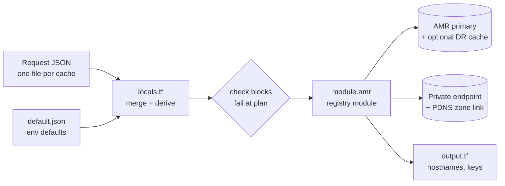
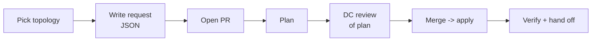

# SOP — Azure Managed Redis Terraform Platform

Sep 24, 2026 · @Sifu

## 1. Purpose, scope and audience

This SOP covers how Azure Managed Redis (AMR) is provisioned, changed, fixed and improved through the platform Terraform stack. It is the one place to look for all four. Application teams self-serve by adding one JSON request file. The DC (Data Cache) team owns everything else.

**In scope**

| Repo                                                | Role                                                                                         | Current version |
| --------------------------------------------------- | -------------------------------------------------------------------------------------------- | --------------- |
| `terraform-azure-dpe-azure-managed-redis-cloud-3-0` | Instance module, published to the Terraform registry under the same name                     | 0.2.2           |
| `Azure-Cld3-CFES-AMR`                               | Onboarding template (root config): `.tf` files, `default.json`, request files, intake schema | 0.0.1           |

**Out of scope:** data-plane work inside Redis (key design, TTLs, application code). Also out of scope: shared VNets and subnets, and creating private DNS zones. Network engineering owns those.

**Responsibilities**

| Activity                                          | App / consumer team           | DC team                                 | DPE team                             | Network / cloud foundation |
| ------------------------------------------------- | ----------------------------- | --------------------------------------- | ------------------------------------ | -------------------------- |
| Submit create / change / delete request file      | Owns                          | Reviews PR                              | Submits via wrapper API              | —                          |
| Topology, SKU, auth mode                          | Chooses within allowed fields | Owns `default.json` and module defaults | Exposes only schema fields           | —                          |
| TLS, public access, private endpoint, delete lock | —                             | Owns (module-enforced)                  | —                                    | —                          |
| Access key storage in vault                       | Consumes                      | **Open**: owner not decided             | **Open**                             | —                          |
| Shared subnet, private DNS zone                   | —                             | Consumes                                | —                                    | Owns                       |
| Module releases and template changes              | —                             | Owns                                    | Validates against Definition of Done | —                          |
| Incident triage and state recovery                | Reports                       | Owns                                    | Supports for wrapper issues          | Supports for network / DNS |

**Conventions:** `<name>` is the request's instance name; `<env>` is one of `dev`, `qa`, `uat`, `prod`.

## 2. Architecture: how the building blocks interact

The stack has four layers: request JSON, the `Azure-Cld3-CFES-AMR` template, the registry module, and Azure. Each request file becomes one `for_each` key, which drives exactly one module call.



The template only shapes inputs and enforces guardrails. The module owns every Azure resource and has no `provider` block, so the template controls subscription and credentials.

### Resolution flow in `locals.tf`

1. **Defaults.** `_defaults_raw` loads `default.json` and selects the block for `var.env`.
2. **Requests.** Load every request JSON for that environment and key it by name.
3. **Field-by-field merge** into `_requested_instances`. A request value wins, otherwise the default is used. A shallow `merge()` is avoided on purpose because it would drop nested defaults.
4. **Derivations.** Build tags and resolve the DR region.
5. **Checks.** `request_names_unique_per_environment` and `dr_requires_supported_region_pair` fail the plan before anything is created.

Subscription, network and DNS values are never taken from a request.

### Topologies

| `deployment_topology` | What gets created                                                                  | Notes                                         |
| --------------------- | ---------------------------------------------------------------------------------- | --------------------------------------------- |
| `Standalone`          | One cache, private endpoint, PDNS link, delete lock                                | Dev/test                                      |
| `HA`                  | One cache with in-region replication                                               | Zone-redundant where the region supports it   |
| `DR-ActivePassive`    | Primary + independent cache in the paired region, each with endpoint and PDNS link | No native replication; DR data sync is manual |
| `DR-ActiveActive`     | Primary + DR cache joined by `azurerm_managed_redis_geo_replication`               | Cannot be combined with data persistence      |

Hard-enforced by the module: TLS (`client_protocol = Encrypted`), public network access disabled, and an `azurerm_management_lock` for delete protection.

### Pipeline

A PR that adds or edits a request file in `Azure-Cld3-CFES-AMR` runs a plan for the target environment. Merge triggers apply. Every run evaluates all request files for that environment together as one plan.

## 3. File-by-file reference

Each file does one job. The "Edit when" column tells you which file a given change goes in.

### Template repo: `Azure-Cld3-CFES-AMR`

```
.
├── main.tf                    # module call, for_each over merged requests
├── locals.tf                  # merge, derivations, check blocks
├── variables.tf               # var.env and root inputs
├── output.tf                  # per-instance outputs
├── default.json               # platform + per-environment defaults
├── redis-intake-schema.json   # contract for the DPE wrapper
├── <name>.json                # one per request (4 topology fixtures)
└── README.md
```

| File                       | What it does                                                                                                                                                        | Edit when                                         |
| -------------------------- | ------------------------------------------------------------------------------------------------------------------------------------------------------------------- | ------------------------------------------------- |
| `main.tf`                  | Calls the module once per merged request. Holds the module `source` and `version` lines.                                                                            | Bumping the module version or passing a new input |
| `locals.tf`                | Loads `default.json` and request files, merges field by field (`_defaults_raw` → `_requested_instances`), derives tags, holds the `check` blocks                    | New request field, new derivation, new guardrail  |
| `variables.tf`             | `var.env` and other root inputs                                                                                                                                     | Adding an environment or pipeline parameter       |
| `output.tf`                | Per-instance hostnames and IDs; `redis_primary_access_keys` (sensitive) for `AccessKey` instances                                                                   | Exposing a new module output                      |
| `default.json`             | Per-environment subscription, region, DR region, subnet and PDNS zone references                                                                                    | New environment, platform default change          |
| `redis-intake-schema.json` | Allowed request fields and enums. It also marks the fields the wrapper must never expose: `client_protocol`, `public_network_access`, networking, and derived tags. | Any request field change                          |
| `<name>.json`              | One self-service request; four fixtures cover Standalone, HA, DR-ActivePassive, DR-ActiveActive                                                                     | Every onboarding, change or decommission          |

### Module repo: `terraform-azure-dpe-azure-managed-redis-cloud-3-0`

| File                                             | What it does                                                                                                                                   |
| ------------------------------------------------ | ---------------------------------------------------------------------------------------------------------------------------------------------- |
| `all-locals.tf`                                  | **The** file for module defaults, including the `environment_profile` map                                                                      |
| Variables file                                   | Inputs and validation: `deployment_topology` enum and `authentication_mode` (`AccessKey` default, or `MicrosoftEntraID`)                       |
| Resource files                                   | `azurerm_managed_redis`, `azurerm_managed_redis_geo_replication`, private endpoints (primary + DR), PDNS zone links, `azurerm_management_lock` |
| Outputs file                                     | Hostname, resource IDs, `redis_primary_access_key` (sensitive)                                                                                 |
| Versions file                                    | `required_providers` only (`azurerm`); no provider block                                                                                       |
| Advisory `check`                                 | Warns that `MicrosoftEntraID` needs a manual data-plane grant                                                                                  |
| `README.md`, `CHANGELOG.md`                      | Usage and version history                                                                                                                      |
| `examples/dev`, `examples/prod-dr-active-active` | Usage samples, not tests                                                                                                                       |

**Open:** add the exact names of the variables, resource, outputs and versions files from the module repo.

### Terraform addresses used in operations

| Object          | Address                                                |
| --------------- | ------------------------------------------------------ |
| Module instance | `module.amr["<name>"]`                                 |
| Cache           | `module.amr["<name>"].azurerm_managed_redis.<label>`   |
| Delete lock     | `module.amr["<name>"].azurerm_management_lock.<label>` |

Replace `amr` and `<label>` with the real names from `main.tf` and the module (`terraform state list` shows them).

## 4. Environment-specific configuration

All environment differences live in `default.json`, not in module code. `var.env` selects which environment block and which request files apply.

### Which values come from where

| Setting                                 | Source                                                      | Request can override?   |
| --------------------------------------- | ----------------------------------------------------------- | ----------------------- |
| Subscription ID                         | `default.json` env block                                    | No                      |
| Subnet, private DNS zone                | `default.json` env block                                    | No                      |
| DR region                               | `default.json` (must be a supported region pair)            | No                      |
| Primary region                          | Request, else `default.json`                                | Yes                     |
| `deployment_topology`, SKU              | Request, else `default.json` / module `environment_profile` | Yes                     |
| `authentication_mode`                   | Request, else default (`AccessKey`)                         | Yes                     |
| TLS, public network access, delete lock | Module-enforced                                             | No                      |
| Tags                                    | Derived; request adds extra                                 | Derived keys always win |

### Environment matrix

| Env  | Typical topology | Auth                      | Notes                                              |
| ---- | ---------------- | ------------------------- | -------------------------------------------------- |
| dev  | Standalone       | `AccessKey`               | Delete lock still applied                          |
| qa   | Standalone or HA | `AccessKey`               | Non-prod network                                   |
| uat  | Match prod       | Match prod                | Rehearse prod topology before go-live              |
| prod | HA or DR         | `MicrosoftEntraID` target | Change approval; no persistence with active-active |

### Rules

- **Request names must be unique** per environment; `request_names_unique_per_environment` fails the plan on a collision.
- **DR regions** must be a supported Azure pair; `dr_requires_supported_region_pair` fails the plan otherwise.
- **One state per environment.** Never apply prod from a non-prod workspace.
- **No real IDs in placeholders.** **Open:** the dev block holds a real subscription GUID while qa/uat/prod hold placeholders; standardize before the repo is shared more widely.

## 5. Prerequisites (one-time per environment)

Three things must exist before the first request in an environment: a deployer identity with the right roles, a shared subnet for private endpoints, and a private DNS zone the deployer can link. Terraform does not create any of them.

### Deployer identity (pipeline service principal)

| Role                                                                                               | Scope                 | Why                               |
| -------------------------------------------------------------------------------------------------- | --------------------- | --------------------------------- |
| Contributor (or custom role with `Microsoft.Cache/redisEnterprise/*`)                              | Target resource group | Create and update caches          |
| Rights to create private endpoints in the subnet                                                   | Shared subnet / VNet  | Private endpoint creation         |
| Rights to create VNet links / records on the zone                                                  | Private DNS zone      | PDNS link                         |
| `Microsoft.Authorization/locks/*` (included in Owner / User Access Administrator, not Contributor) | Resource group        | Create and remove the delete lock |

The roles must be granted to the **pipeline identity**, not only to an engineer's user account.

### Networking

- A shared subnet for private endpoints exists in the primary region and, for DR, in the paired region.
- The private DNS zone for AMR exists and is linked to every VNet that clients resolve from.
- NSGs allow TCP 10000 from client subnets to the endpoint subnet.

### Onboarding checklist for a new environment

- [ ] Pipeline identity roles granted on RG, subnet and DNS zone
- [ ] Endpoint subnet present in primary and DR regions
- [ ] Private DNS zone linked to client VNets
- [ ] Environment block added to `default.json` with real IDs
- [ ] Workspace/state for the environment created
- [ ] Smoke test: a Standalone request applies, resolves privately and answers `PING`

## 6. Self-service provisioning procedure

A new cache is one new JSON file in `Azure-Cld3-CFES-AMR`, merged through a reviewed PR. No `.tf` edits and no manual Terraform commands.



### Step 1 — Choose topology

| Need                                                        | Choose             |
| ----------------------------------------------------------- | ------------------ |
| Test / disposable cache                                     | `Standalone`       |
| In-region failover                                          | `HA`               |
| Cold standby in another region, manual data sync acceptable | `DR-ActivePassive` |
| Cross-region continuity, no persistence needed              | `DR-ActiveActive`  |

### Step 2 — Create the request file

Copy the fixture that matches the topology to `<name>.json` and fill only fields in `redis-intake-schema.json`: name, environment, topology, SKU, auth mode, tags.

- The name must be unique per environment.
- Omit any field to inherit `default.json`.
- Never set subscription, network, DNS, TLS or public access fields.
- Validate the file against the schema before raising the PR.

### Step 3 — Review the plan (DC team)

- [ ] Only the new key is created: cache, private endpoint, PDNS link and delete lock. DR topologies create the DR set as well, and active-active adds one geo-replication resource.
- [ ] Zero changes or destroys on any other key
- [ ] Region and DR region are as expected
- [ ] No check-block failures or warnings

### Step 4 — Merge and apply

Merging triggers apply. DR applies take longest because the DR cache follows the primary.

### Step 5 — Verify and hand off

```bash
az resource show --ids <amr-resource-id> --query properties.hostName -o tsv
nslookup <hostname>          # from a client VNet: must return a private IP
```

- A TLS `PING` on port 10000 returns `PONG`.
- The delete lock is present on the resource.
- Share the hostname and port 10000 with the requesting team, then give access (section 8).

## 7. Configuration changes and decommissioning

Every change is an edit to the request file, or to `default.json` for defaults that apply across the platform. It goes through the same PR flow as a new cache. An in-place `update` is normal. A `replace` recreates the cache and loses its data.

### Change matrix

| Change                           | Edit                         | Expected plan                                       | Change class                            |
| -------------------------------- | ---------------------------- | --------------------------------------------------- | --------------------------------------- |
| Tags                             | Request                      | Update in place                                     | Standard                                |
| SKU scale-up                     | Request                      | Update in place (verify)                            | Infra change                            |
| `AccessKey` → `MicrosoftEntraID` | Request                      | Update in place                                     | Infra change; clients must switch first |
| Standalone → HA                  | Request                      | May replace                                         | Infra change + maintenance window       |
| Add DR                           | Request                      | Adds DR cache, endpoint, PDNS link, geo-replication | Infra change                            |
| Persistence on `DR-ActiveActive` | —                            | Rejected by Azure                                   | Not allowed                             |
| Region or name change            | Request                      | **Destroy and recreate**                            | Treat as new cache + migration          |
| New environment                  | `default.json`               | No resources until requested                        | Platform change                         |
| Module upgrade                   | Template `main.tf` `version` | Varies                                              | Platform release (section 10)           |

### Procedure for an in-place change

1. Edit only the fields you need in `<name>.json`. Never create a second file for the same cache.
2. Open a PR. Confirm the plan shows `~ update in-place` for your key only, with no `-/+` on `azurerm_managed_redis`.
3. For uat/prod, attach the plan to the change record.
4. Merge, apply, then rerun the verify step from section 6.

### Decommission one cache

1. Get DC approval, then remove the delete lock deliberately. The destroy will fail with the lock in place, by design.
2. Remove the request file (or mark it for deletion, per the template convention) and merge. The plan must destroy only that key.
3. Delete the stored access key from the vault.

### Never do

- Run `terraform destroy` on an environment workspace.
- Change caches in the portal; the next apply reverts or conflicts.
- Reuse a name from another request file in the same environment.

## 8. Consumer access and connectivity

A client needs a private network path and a credential. The credential depends on `authentication_mode`.

| Mode                  | Credential                                        | How it is issued                                                                                                                      |
| --------------------- | ------------------------------------------------- | ------------------------------------------------------------------------------------------------------------------------------------- |
| `AccessKey` (default) | Primary access key                                | `terraform output -json redis_primary_access_keys`, stored in the vault. **Open:** the vault write is manual, and no one owns it yet. |
| `MicrosoftEntraID`    | Entra token for the app's managed identity or SPN | The data-plane grant is manual, outside Terraform. azurerm cannot automate it yet, and the module's advisory check warns about this.  |

### Connecting

1. The client runs in a VNet linked to the private DNS zone, with a route to the endpoint subnet.
2. Connect to `<hostname>:10000` with TLS.
3. Smoke test with `PING`, then `SET` / `GET` of a test key.

### Limits to communicate to consumers

- **Never paste keys** into tickets or chat; fetch them from the vault.
- **Data in memory is not encrypted.** Encrypt sensitive fields in the application before writing them.
- **Active-active has no persistence.** Treat the cache as rebuildable from the source of truth.
- **Conditional Access.** Entra ID tokens are subject to Conditional Access. A request from an untrusted egress, such as Databricks, can fail with `AADSTS53003`. See section 9.

## 9. Troubleshooting runbook

Start with the error text, find its row, and apply the fix. Always run a plan after a fix and before an apply.

### Known errors

| Symptom                                            | Cause                                                                            | Fix                                                                                                                                                          |
| -------------------------------------------------- | -------------------------------------------------------------------------------- | ------------------------------------------------------------------------------------------------------------------------------------------------------------ |
| `Module not found` at `terraform init`             | Template `source` points at a local `./modules/...` path instead of the registry | Use the registry source and `version` (section 10); run `terraform init -upgrade`                                                                            |
| `An argument named "X" is not expected here`       | Template pins a module version older than the input it passes                    | Bump `version` in `main.tf`; `terraform init -upgrade`                                                                                                       |
| Check `request_names_unique_per_environment` fails | Two request files share a name in one environment                                | Rename one, or edit the existing request                                                                                                                     |
| Check `dr_requires_supported_region_pair` fails    | DR region is not the primary's supported pair                                    | Use the paired region from `default.json`                                                                                                                    |
| Advisory warning about `MicrosoftEntraID`          | Data-plane grant cannot be automated                                             | Expected; do the manual grant after apply                                                                                                                    |
| `403` / `AuthorizationFailed` on apply             | Pipeline identity lacks rights on RG, subnet, DNS zone or locks                  | Grant the role to the pipeline identity (section 5); wait a few minutes; re-run                                                                              |
| Destroy blocked by lock                            | Delete lock working as designed                                                  | Remove the lock with DC approval, then destroy                                                                                                               |
| DR private endpoint or PDNS link missing / wrong   | Module older than 0.0.4                                                          | Upgrade to 0.0.4+ (latest 0.2.2) and re-apply                                                                                                                |
| Persistence rejected on `DR-ActiveActive`          | Azure: geo-replication and persistence are mutually exclusive                    | Use HA with persistence, or active-active without it                                                                                                         |
| Hostname resolves to a public IP or not at all     | Client VNet not linked to the private DNS zone                                   | Network team links the VNet                                                                                                                                  |
| Timeout on port 10000                              | NSG or route blocks the client subnet                                            | Allow TCP 10000 from the client subnet                                                                                                                       |
| `AADSTS53003` requesting a token                   | Conditional Access blocks the token request (for example Databricks egress IP)   | Look up the Correlation ID in Entra ID → Sign-in logs; ask the CA owners to allowlist the egress or exclude the identity. Access keys are not subject to CA. |
| `PING` fails with auth error on Entra ID           | Entra authentication not enabled on the cache, or no data-plane grant            | Enable on the Authentication blade; complete the grant                                                                                                       |
| Secret scanner flags a GUID                        | Client/object/subscription IDs near words like `secret`                          | Not a secret; add a scoped ignore. Real secrets stay `sensitive` with no default                                                                             |
| Plan shows `-/+` on the cache                      | Field change forces replacement                                                  | Stop; treat as migration or revert the field                                                                                                                 |

### Useful diagnostics

```bash
terraform state list | grep '<name>'
terraform plan -refresh-only                         # detect portal drift
az resource show --ids <amr-resource-id> --query properties.hostName -o tsv
nslookup <hostname>                                  # private IP check
```

### Escalation

| Level | Who                                              | When                                             |
| ----- | ------------------------------------------------ | ------------------------------------------------ |
| L1    | App team                                         | Request-file and schema errors                   |
| L2    | DC team                                          | Plan/apply failures, state recovery, module bugs |
| L3    | Network team / identity team / Microsoft support | Subnet, DNS, Conditional Access, capacity        |

## 10. Continuous enhancement

The module evolves through semver releases to the Terraform registry. The template adopts a new version through a normal PR. Each change goes in the layer that owns it.

### Where a change belongs

| Change                                                     | Layer                                         | Release needed                       |
| ---------------------------------------------------------- | --------------------------------------------- | ------------------------------------ |
| New default value                                          | `default.json`                                | No, template PR                      |
| New environment, subnet or DNS zone                        | `default.json`                                | No, template PR                      |
| New module-wide default                                    | Module `all-locals.tf`                        | Yes, minor                           |
| New input or output                                        | Module, then template `main.tf` / `output.tf` | Yes, minor                           |
| Removed/renamed input, or a change that forces replacement | Module                                        | Yes, **major**, with migration notes |
| New request field                                          | Template `locals.tf` + intake schema          | No                                   |

### Release procedure (module repo)

1. Branch, change code, update `README.md` and `CHANGELOG.md`.
2. Run `terraform fmt -recursive` and `terraform validate`. Plan all four topology fixtures against a dev workspace, using the branch as the source.
3. PR review by a second DC engineer.
4. Merge, then tag and push:

```bash
git checkout main && git pull origin main
git fetch --tags
git tag --sort=-v:refname | head -5
git tag -a vX.Y.Z -m "vX.Y.Z: <summary>"
git push origin vX.Y.Z
```

5. The registry publishes the tag as a new version.
6. Template PR in `Azure-Cld3-CFES-AMR`: bump `version`, plan in every environment, promote dev → qa → uat → prod.

```hcl
module "amr" {
  source  = "<registry-host>/<ORG>/dpe-azure-managed-redis-cloud-3-0/azure"
  version = "~> 0.2"   # latest 0.2.2; 0.0.4 is the minimum supported version
}
```

**Tag rules:** tags are immutable. Never move a published tag; fix forward with a new patch version.

### Module release history

| Version         | Type             | What changed                                                                                                                                                                                                                               | Why                                                                         |
| --------------- | ---------------- | ------------------------------------------------------------------------------------------------------------------------------------------------------------------------------------------------------------------------------------------ | --------------------------------------------------------------------------- |
| 0.0.1           | Initial          | To be filled from `CHANGELOG.md`                                                                                                                                                                                                           | —                                                                           |
| 0.0.2           | Patch            | To be filled from `CHANGELOG.md`                                                                                                                                                                                                           | —                                                                           |
| 0.0.3           | Topology release | Four-way `deployment_topology` (Standalone, HA, DR-ActivePassive, DR-ActiveActive) with DR-region private endpoint and PDNS link                                                                                                           | One input decides the topology                                              |
| 0.0.4           | Patch            | Fixed three DR networking bugs: wrong dependency reference, inverted `count` condition, wrong DNS-link argument shape. All four topologies tested live.                                                                                    | 0.0.3 DR private endpoint and PDNS link were broken. **Minimum supported.** |
| 0.1.0           | Minor            | To be filled from `CHANGELOG.md`                                                                                                                                                                                                           | —                                                                           |
| 0.2.0           | Minor            | To be filled from `CHANGELOG.md`                                                                                                                                                                                                           | —                                                                           |
| 0.2.1           | Patch            | To be filled from `CHANGELOG.md`                                                                                                                                                                                                           | —                                                                           |
| 0.2.2           | Patch            | To be filled from `CHANGELOG.md`                                                                                                                                                                                                           | **Latest**                                                                  |
| Next (proposed) | Minor            | Optional `redis_modules` input (RediSearch, RedisJSON, RedisBloom, RedisTimeSeries) with name/duplicate validation and preconditions: active-active allows only RediSearch/RedisJSON, RediSearch forces `EnterpriseCluster` + `NoEviction` | Consumer request for search/JSON; changing the list replaces the cache      |

**Template milestones:** `0.0.1` introduced the JSON request layer, intake schema and the two plan-time checks.

**Open:** fill in what changed for 0.0.1, 0.0.2 and 0.1.0–0.2.2, plus release dates, from `CHANGELOG.md`. Confirm the topology release was 0.0.3; earlier notes called it 4.0.0, and the fix release 4.1.0 shipped as `amrmodulev0.0.4`.

### Enhancement backlog

- [ ] Decide the owner for writing access keys to the vault, then automate the write
- [ ] Automated data-plane grant for `MicrosoftEntraID` once azurerm supports it
- [ ] Alerting module (mirror the Valkey alerts module)
- [ ] Customer-managed key encryption (roadmap in module README)
- [ ] Diagnostic settings / audit logs to the central workspace
- [ ] CI: plan every topology fixture on each module PR; fail on duplicate names and schema-invalid requests
- [ ] Runbook for `DR-ActivePassive` data sync, or accept rebuild-from-source
- [ ] Scheduled `terraform plan -refresh-only` per environment for drift

## 11. Appendix

### A. Request fields

| Field                 | Default source                         | Notes                                                     |
| --------------------- | -------------------------------------- | --------------------------------------------------------- |
| `name`                | Required                               | Unique per environment                                    |
| `environment`         | Required                               | Must match `var.env`                                      |
| `deployment_topology` | `default.json` / `environment_profile` | `Standalone`, `HA`, `DR-ActivePassive`, `DR-ActiveActive` |
| SKU                   | `default.json` / `environment_profile` | Scale-up usually in place                                 |
| `authentication_mode` | `AccessKey`                            | `MicrosoftEntraID` needs a manual grant                   |
| Location              | `default.json`                         | DR region always derived                                  |
| Tags                  | Derived                                | Extra tags allowed; derived keys win                      |

`redis-intake-schema.json` is the authoritative list.

### B. Guardrail checks

| Check                                  | Where                | Stops                                                 |
| -------------------------------------- | -------------------- | ----------------------------------------------------- |
| `request_names_unique_per_environment` | Template `locals.tf` | Two requests with the same name                       |
| `dr_requires_supported_region_pair`    | Template `locals.tf` | DR to an unpaired region                              |
| `deployment_topology` validation       | Module               | Unknown topology values                               |
| TLS / public access enforcement        | Module               | Unencrypted or public caches                          |
| Delete lock                            | Module               | Accidental deletion                                   |
| Entra ID advisory check                | Module               | Forgetting the manual data-plane grant (warning only) |

### C. Quick commands

```bash
terraform init
terraform plan -var="env=dev"
terraform output -json redis_primary_access_keys    # sensitive: pipe to vault, never print in CI logs
terraform state list
az resource show --ids <amr-resource-id> --query properties.hostName -o tsv
```
