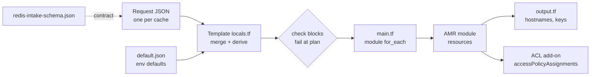
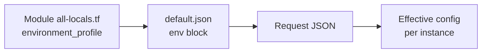
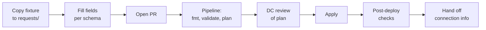

# SOP: Azure Managed Redis Terraform Template & Modules

Sep 24, 2026 · @Sifu

## 1. Purpose and scope

This SOP is the single operating guide for provisioning, changing, troubleshooting and enhancing Azure Managed Redis (AMR) through the DC team's Terraform solution. It covers three layers: the reusable AMR module, the JSON onboarding template that calls it, and the data-plane access (ACL) add-on.

| Audience | Uses this SOP to |
| --- | --- |
| Consuming engineering teams | Request a new cache or a change through a JSON request file |
| DC team (module owners) | Review requests, run plan/apply, release new module versions |
| DPE team (wrapper API) | Map the intake schema to the Core Services API and validate against the Definition of Done |
| Support / on-call | Diagnose failed runs, connectivity and auth issues |

**Versions covered.** Module `terraform-azure-dpe-azure-managed-redis-cloud-3-0` (CHANGELOG v4.1.0, delivered as `amrmodulev0.0.4`), onboarding template `amrtemplate0.0.1`, and the ACL add-on built against API `2026-05-01-preview`. Anything older than module 4.1.0 has known DR networking bugs and is out of scope.

**Out of scope.** GCP Memorystore for Valkey (separate module and SOP), application-side caching patterns, and tenant compliance sign-off (BAA/PHI-in-cache policy), which must be settled before a request is raised.

**Conventions.** `code` = file, variable or command. "Request file" = one JSON file per cache request. Items marked **Open** are unresolved in the Definition of Done and have no owner yet.

## 2. How the building blocks interact

A request flows one way: a JSON request file is merged with environment defaults in the onboarding template, validated at plan time, and fanned out to one module call per instance. The module owns every Azure resource; the template owns input shaping and guardrails; the ACL add-on runs after the cache exists.



Read left to right: inputs, shaping, guardrails, provisioning, outputs. The dotted line is a contract, not a runtime dependency.

| Layer | Owns | Does not own |
| --- | --- | --- |
| Request JSON | Business inputs: name, environment, topology, size, auth mode | Networking, TLS, public access, tags |
| `default.json` | Per-environment defaults (subscription, region, network references) | Instance-specific choices |
| Template `locals.tf` | Field-by-field merge (`_defaults_raw` → `_requested_instances`), derived tags | Azure resources |
| Template `check` blocks | `request_names_unique_per_environment`, `dr_requires_supported_region_pair` | Runtime health |
| AMR module | Cache, DR/geo-replication, private endpoints, DNS links, delete lock | Provider configuration, secrets vault |
| ACL add-on | Entra ID data-plane access strings per service principal | Creating the cache |

### Module resource graph

Inside the module, a single `deployment_topology` value drives which resources are created.

| `deployment_topology` | Resources created | Notes |
| --- | --- | --- |
| `Standalone` | 1 cache, 1 private endpoint, DNS zone link, management lock | Dev/test default |
| `HA` | 1 cache with replication across nodes/zones, endpoint, DNS, lock | Zone-redundant where region supports it |
| `DR-ActivePassive` | Primary + independent DR cache in the paired region, endpoint + DNS link for each | No native replication; DR data sync is manual |
| `DR-ActiveActive` | Primary + DR cache joined by `azurerm_managed_redis_geo_replication`, endpoints + DNS for both | Not compatible with data persistence |

Fixed by design and not overridable: TLS client protocol `Encrypted`, public network access disabled, `azurerm_management_lock` for delete protection, and no `provider` block inside the module.

## 3. Repository layout and file reference

The solution is one root (the onboarding template) with the module nested under `modules/`, plus a separate ACL add-on root. The template's `main.tf` expects the module at `./modules/terraform-azure-dpe-azure-managed-redis-cloud-3-0`; the delivered zip ships it as a sibling folder `amrmodulev0.0.4/`, so rename or move it before `terraform init` (see Troubleshooting T1).

```
amr-redis/
├── README.md
├── main.tf                     # module call, for_each over requests
├── variables.tf                # root inputs (environment, request dir)
├── locals.tf                   # JSON merge, derived tags, check blocks
├── output.tf                   # per-instance outputs
├── default.json                # environment defaults (dev/qa/uat/prod)
├── redis-intake-schema.json    # contract for DPE wrapper
├── requests/                   # one JSON per cache (+ 4 topology fixtures)
└── modules/
    └── terraform-azure-dpe-azure-managed-redis-cloud-3-0/
        ├── README.md  CHANGELOG.md
        ├── all-locals.tf       # defaults + environment_profile map
        ├── *.tf                # resources, variables, outputs, versions
        └── examples/
            ├── dev/
            └── prod-dr-active-active/
amr-acl/                        # data-plane access add-on
├── main.tf
└── test_redis_acl.py
```

### Onboarding template (root)

| File | Purpose | Edit when |
| --- | --- | --- |
| `main.tf` | Calls the module once per merged request via `for_each`; passes topology, SKU, auth mode, network references and derived tags | Adding a new module input or bumping the module source/version |
| `variables.tf` | Root inputs: target environment and where request files live | Rarely; new pipeline parameters |
| `locals.tf` | Loads `default.json` and every request JSON, merges field by field (`_defaults_raw` → `_requested_instances`), derives tags, hosts `check` blocks | New request field, new derived value, new guardrail |
| `output.tf` | Hostnames/IDs per instance and `redis_primary_access_keys` (sensitive) for `AccessKey` instances | New consumer-facing output |
| `default.json` | Environment blocks for dev, qa, uat, prod: subscription ID, region, DR region, network/DNS references | Onboarding a new environment or subnet |
| `redis-intake-schema.json` | JSON Schema for request files; marks fields the wrapper must never expose (`client_protocol`, `public_network_access`, networking, derived tags) | Any change to request fields |
| `requests/*.json` | One file per cache; four fixtures cover Standalone, HA, DR-ActivePassive, DR-ActiveActive | Every new cache or change |
| `README.md` | Usage and field guide | With every behavior change |

### AMR module

| File | Purpose | Edit when |
| --- | --- | --- |
| `all-locals.tf` | Single home for defaults and the `environment_profile` map (per-environment SKU/topology defaults) | Changing a platform default |
| Resource `.tf` files | `azurerm_managed_redis`, `azurerm_managed_redis_geo_replication` (active-active), private endpoints (primary + DR), private DNS zone links, `azurerm_management_lock` | New capability or bug fix |
| Variables file | Inputs with validation, including the `deployment_topology` enum and `authentication_mode` (`AccessKey` default, or `MicrosoftEntraID`) | New input |
| Outputs file | Hostname, resource IDs, `redis_primary_access_key` (sensitive) | New output |
| Versions file | `azurerm` provider constraint; no `provider` block | Provider upgrade |
| Advisory `check` | Warns that `MicrosoftEntraID` needs a manual data-plane grant | When azurerm adds automation |
| `CHANGELOG.md` | Semver history; 4.1.0 fixed three DR networking bugs | Every release |
| `examples/` | `dev` (standalone) and `prod-dr-active-active` usage samples, not tests | When inputs change |

**Open:** confirm the exact resource/variable/output filenames in the module repo and paste them into this table; the review only surfaced `all-locals.tf` by name.

### ACL add-on

| File | Purpose |
| --- | --- |
| `main.tf` | Providers `azurerm ~> 4.0`, `azuread ~> 3.0`, `azapi ~> 2.0`; looks up an existing SPN by `spn_client_id`; creates `azapi_resource` of type `Microsoft.Cache/redisEnterprise/databases/accessPolicyAssignments@2026-05-01-preview` with an access string (reader `+@read ~*`, writer `+@read +@write -@dangerous ~*`, admin `+@all ~*`); outputs `spn_object_id`, `spn_client_id` |
| `test_redis_acl.py` | Gets an Entra token for the SPN, connects over TLS on port 10000, probes read/write/admin commands and reports ALLOWED/DENIED |

## 4. Environment-specific configuration

Environment settings live in two places and resolve in a fixed order: module `environment_profile` defaults, then `default.json` for the environment, then the request file. The last value wins, field by field, so a request only states what differs.



| Environment | Subscription source | Typical topology | Auth default | Guardrails |
| --- | --- | --- | --- | --- |
| dev | `default.json` → dev block | Standalone | `AccessKey` | Delete lock still applied |
| qa | `default.json` → qa block | Standalone or HA | `AccessKey` | Same as dev |
| uat | `default.json` → uat block | HA or DR (prod rehearsal) | Match prod | Mirror prod topology before go-live |
| prod | `default.json` → prod block | HA, DR-ActivePassive or DR-ActiveActive | Target `MicrosoftEntraID` | Change approval, DR region pair check, no persistence with active-active |

### Example environment block (`default.json`)

```json
{
  "prod": {
    "subscription_id": "<prod-subscription-id>",
    "location": "eastus",
    "dr_location": "westus",
    "resource_group_name": "<rg>",
    "private_endpoint_subnet_id": "<shared subnet id>",
    "private_dns_zone_id": "<existing PDNS zone id>",
    "deployment_topology": "HA",
    "authentication_mode": "MicrosoftEntraID"
  }
}
```

Field names are illustrative; the authoritative list is `redis-intake-schema.json`.

### Rules for environment configuration

- Networking (subnet, private DNS zone) comes from the platform's existing shared subnets and PDNS zones. Requests never carry network IDs.
- One state file per environment (separate backend key or workspace). Never apply prod from a dev state.
- Subscription IDs are identifiers, not secrets, but keep them out of public repos. **Open:** the dev block currently holds a real subscription GUID while qa/uat/prod hold placeholders; standardize before sharing the repo.
- DR regions must be a supported Azure region pair; the `dr_requires_supported_region_pair` check fails the plan otherwise.
- Request names must be unique per environment; `request_names_unique_per_environment` fails the plan on collision.

## 5. Prerequisites and access

Confirm every item below before raising or applying a request; most failed runs trace back to one of them.

| Prerequisite | Who provides it | How to verify |
| --- | --- | --- |
| Terraform CLI and providers `azurerm ~> 4.0` (plus `azuread ~> 3.0`, `azapi ~> 2.0` for ACLs) | Engineer / pipeline image | `terraform version` |
| Azure CLI session or pipeline identity on the target subscription | Engineer / DC pipeline | `az account show` |
| Contributor (or custom role incl. `Microsoft.Cache/redisEnterprise/*` and `accessPolicyAssignments/write`) on the resource group | Subscription owner | RG → Access control (IAM) → View my access |
| Network rights to create private endpoints in the shared subnet and link to the existing PDNS zone | Network team | Test plan shows endpoint + DNS link without 403 |
| Environment block present in `default.json` | DC team | Block exists with real IDs, not placeholders |
| Remote state backend per environment | DC team | `terraform init` succeeds against the backend |
| Tenant compliance sign-off (data classification, PHI-in-cache decision) | Requesting team + compliance | Recorded in the request ticket |
| For Entra ID auth: an existing SPN or managed identity per consuming app | Identity team / app team | `az ad sp show --id <client-id> --query id -o tsv` |

**Secrets handling.** Never put client secrets or access keys in `.tf` or request files. Pass them through environment variables or the pipeline secret store, and declare them `sensitive = true`. When generating a new SPN secret, use `az ad app credential reset --append`; without `--append` it deletes the app's existing secrets.

## 6. Self-service provisioning

A new cache is one new JSON file in `requests/`, reviewed through a pull request and applied by the pipeline. Consuming teams never edit `.tf` files.



### Steps

1. **Choose the topology.** Standalone for dev/test, HA for single-region production, DR-ActivePassive when a cold standby is acceptable, DR-ActiveActive when cross-region continuity matters more than persistence.
2. **Copy the matching fixture** from `requests/` (standalone, HA, DR-active-passive, DR-active-active) to `requests/<app>-<env>.json`.
3. **Fill only schema fields**: name, environment, topology, SKU/size, authentication mode, owner/cost tags as the schema allows. Do not add networking, TLS or public access fields; they are fixed.
4. **Validate locally** (optional but fast):

   ```bash
   terraform init
   terraform fmt -check
   terraform validate
   terraform plan -out=tfplan
   ```
5. **Open a pull request.** The pipeline runs the same commands and posts the plan.
6. **DC review the plan.** Expected resource counts per topology:
   - Standalone / HA: cache, private endpoint, DNS link, management lock.
   - DR-ActivePassive: the above twice (primary + DR region).
   - DR-ActiveActive: the above twice plus one geo-replication resource.
   - Any `destroy` or `replace` on an existing cache is a stop; escalate.
7. **Apply** from the merged branch: `terraform apply tfplan`.
8. **Post-deploy checks.**
   - Portal or `az resource show ... --query properties.hostName -o tsv` returns the hostname.
   - Hostname resolves to a private IP from a client VNet (`nslookup <host>`).
   - TLS connection on port 10000 succeeds; `PING` returns `PONG`.
   - Management lock is present on the resource.
9. **Hand off connection details.** Hostname and port go in the ticket. For `AccessKey` instances, retrieve the key with `terraform output -json redis_primary_access_keys` and store it in the team vault; never paste it in chat or tickets. **Open:** no automated vault write exists yet; this step is manual until an owner is assigned.
10. **For Entra ID instances,** grant data-plane access with the ACL add-on (section 7.3), then run `test_redis_acl.py` to confirm.

## 7. Configuration changes

Every change goes through the same PR → plan → review → apply path as provisioning; the difference is how carefully the plan is read. An in-place `update` is normal; a `replace` recreates the cache and loses its data.

### 7.1 Change risk matrix

| Change | Where | Expected plan | Risk | Approval |
| --- | --- | --- | --- | --- |
| Tags, owner, cost center | Request JSON | Update in place | Low | DC reviewer |
| SKU scale-up within family | Request JSON | Update in place (verify) | Medium | DC reviewer + app owner |
| Auth mode `AccessKey` → `MicrosoftEntraID` | Request JSON | Update in place, then manual/ACL grant | Medium: clients must switch before keys are disabled | App owner confirms client readiness |
| Standalone → HA | Request JSON | May replace | High | Change board; plan in maintenance window |
| Add DR (HA → DR-\*) | Request JSON | Adds DR cache, endpoint, DNS, geo-replication | Medium | Change board |
| Enable persistence on DR-ActiveActive | Not allowed | — | Blocked by platform | — |
| Rename instance | Not supported | Replace | High | Treat as new cache + migration |
| New environment | `default.json` | No resources until requested | Low | DC lead |
| Module version bump | Template `main.tf` source | Varies | Medium–High | Section 9 release process |

### 7.2 Procedure

1. Edit the existing request file; never create a second file for the same cache (the uniqueness check will fail).
2. Open a PR and read the plan. Look for `must be replaced` or `-/+` on `azurerm_managed_redis`. If present and not expected, stop.
3. For production, attach the plan output to the change record and schedule a window.
4. Apply, then rerun the post-deploy checks from section 6 step 8.
5. Deleting a cache: remove the request file, then remove the management lock deliberately with DC approval. The lock will otherwise block the destroy by design.

### 7.3 Granting data-plane access (Entra ID)

1. Get the SPN object ID: `az ad sp show --id <client-id> --query id -o tsv`.
2. In the ACL add-on, set `resource_group_name`, `amr_cache_name`, `database_name` (usually `default`) and `spn_client_id`.
3. Pick the access string: reader `+@read ~*`, writer `+@read +@write -@dangerous ~*`, admin `+@all ~*`.
4. Name the assignment with letters and digits only (e.g. `spnreadassignment`); hyphens fail schema validation.
5. `terraform plan -out=tfplan` should show one resource to add; apply it.
6. Confirm Microsoft Entra authentication is enabled on the cache (Authentication blade), then run `test_redis_acl.py` with `AZURE_TENANT_ID`, `AZURE_CLIENT_ID`, `AZURE_CLIENT_SECRET`, `REDIS_HOST`, `REDIS_USERNAME` (the SPN object ID). Reader should see GET allowed and SET denied with `NOPERM`.

## 8. Troubleshooting

Work out which stage failed first (init, plan, apply, connect, authorize), then use the matching row. Each entry below was hit or flagged during the build and review of this solution.

| ID | Stage | Symptom | Cause | Fix |
| --- | --- | --- | --- | --- |
| T1 | init | `Module not found` / source path error | Template points to `./modules/terraform-azure-dpe-azure-managed-redis-cloud-3-0`; zip ships `amrmodulev0.0.4/` as a sibling | Move/rename module folder under `modules/` with the expected name, or point `source` at the registry tag |
| T2 | plan | Check `request_names_unique_per_environment` fails | Two request files share a name in one environment | Rename one, or merge into the existing request |
| T3 | plan | Check `dr_requires_supported_region_pair` fails | DR region is not the primary's supported pair | Use the paired region from `default.json` |
| T4 | plan | `embedded schema validation failed ... string does not match pattern ^[A-Za-z0-9]{1,60}$` | ACL assignment `name` contains hyphens | Use letters/digits only, e.g. `spnreadassignment`; the Terraform resource label may keep underscores |
| T5 | plan | Advisory warning about `MicrosoftEntraID` | azurerm cannot automate the Entra data-plane grant yet | Run the ACL add-on (7.3) after apply |
| T6 | apply | 403 / `AuthorizationFailed` | Runner identity lacks rights on RG, subnet or PDNS zone | Grant Contributor or the scoped custom role; re-run |
| T7 | apply | Destroy blocked by lock | `azurerm_management_lock` working as designed | Remove the lock deliberately with DC approval, then destroy |
| T8 | apply | DR endpoint or DNS link missing/wrong | Module older than 4.1.0 (three DR networking bugs) | Upgrade to 4.1.0+ and re-apply |
| T9 | apply | Persistence rejected on DR-ActiveActive | Platform: active geo-replication and persistence are mutually exclusive | Pick one; use HA + persistence or active-active without it |
| T10 | connect | Hostname resolves to public IP or not at all | Client VNet not linked to the private DNS zone | Link the VNet to the PDNS zone (network team) |
| T11 | connect | Timeout on port 10000 | NSG/route blocks client subnet to endpoint subnet | Allow TCP 10000 from client subnet |
| T12 | authorize | `AADSTS53003` when requesting a token | Conditional Access blocks the token request (e.g. Databricks egress IP not trusted) | Look up the Correlation ID in Entra ID → Sign-in logs; ask CA owners to allowlist egress or exclude the SPN. Short-term test: use access keys |
| T13 | authorize | `PING` fails with auth error for SPN | Entra authentication not enabled on the cache, or no access policy assignment | Enable on the Authentication blade; apply the ACL add-on |
| T14 | authorize | `NOPERM` on a command | Access string does not include that command category | Expected for reader/writer; change access string if the app needs it |
| T15 | authorize | SET succeeds for a reader SPN | Access string did not land as intended | `az resource show` on the `accessPolicyAssignments` sub-resource and compare |
| T16 | security scan | Secret scanner flags a GUID | Client/object IDs near words like `secret` | Not a secret; add a scoped ignore rule. Real secrets must stay `sensitive` with no default |

### Useful commands

```bash
az ad sp show --id <client-id> --query id -o tsv          # SPN object ID
az resource show --ids <amr-resource-id> --query properties.hostName -o tsv
terraform state list | grep managed_redis                  # what Terraform manages
terraform plan -refresh-only                               # detect portal drift
nslookup <hostname>                                        # private IP check
```

Escalate to the DC team when a plan shows an unexpected replace, when state and Azure disagree after a refresh, or when a fix needs a module change.

## 9. Continuous enhancement

The module and template evolve through semver releases; consumers pin a tag and upgrade on purpose. Any change that alters the request schema is a DPE contract change and needs their sign-off.

### 9.0 Module release history

The current module release is 4.1.0. It is the minimum supported version because 4.0.0 shipped broken DR networking. Rows are newest first. Only the releases recorded in the project's review chats are listed.

| Version | Delivered as | Type | Why it was released | Status |
| --- | --- | --- | --- | --- |
| Next (proposed) | Not released | Minor | Adds an optional `redis_modules` input (RediSearch, RedisJSON, RedisBloom, RedisTimeSeries). Validation covers names, aliases and duplicates. Preconditions block unsupported combinations: active-active allows only RediSearch/RedisJSON; Flash Optimized allows only RedisJSON; RediSearch forces `EnterpriseCluster` + `NoEviction`. | Design drafted; changing the module list replaces the cache, so the change note must say so |
| 4.1.0 | `amrmodulev0.0.4` zip | Patch | Fixed three DR-region networking bugs from 4.0.0: a wrong dependency reference, an inverted `count` condition, and the wrong argument shape on the DNS zone link. All four topologies were then tested live. | **Current, minimum supported** |
| 4.0.0 | — | Major | Introduced the four-way `deployment_topology` (Standalone, HA, DR-ActivePassive, DR-ActiveActive) with DR-region private endpoint and DNS link | Superseded; do not use for DR topologies |

The onboarding template versions separately: `amrtemplate0.0.1` is its first release. It added the JSON request layer, the intake schema and the uniqueness and DR region-pair checks.

**Open:**

- Record releases before 4.0.0 from `CHANGELOG.md`.
- Record the release date for each row.
- Reconcile the three version labels: the zip name (`v0.0.4`), the CHANGELOG (`4.1.0`) and the module folder name (`cloud-3-0`). Pick one tag scheme for consumers to pin.

### 9.1 Release process

1. Branch, change code, update `README.md`, `CHANGELOG.md` and `redis-intake-schema.json` if inputs changed.
2. Run `terraform fmt`, `terraform validate` and a plan for all four topology fixtures.
3. Apply each fixture in a sandbox subscription and run post-deploy checks; attach logs to the PR as test evidence.
4. Tag the release: patch = fixes, minor = new optional inputs, major = removed/renamed inputs or any change that forces replacement.
5. Bump the module `source` ref in the template `main.tf`; roll through dev → qa → uat → prod.

### 9.2 Backlog from the Definition of Done

| Item | Status | Notes |
| --- | --- | --- |
| Vault integration for access keys | Open, no owner | Keys currently sit in state and a sensitive output; decide DC vs DPE ownership |
| Automated Entra ID data-plane grant | Partial | ACL add-on works via `azapi` preview API; fold into module when stable |
| Automated test suite / CI | Not started | Fixtures exist; add plan-per-fixture in CI, then apply tests (e.g. Terratest) |
| Alerting module | Not started | Valkey already has a separate alerts module to mirror |
| Customer-managed key encryption | Roadmap | Listed in module README |
| DR-ActivePassive data sync | Manual | Document a runbook or accept rebuild-from-source |
| Diagnostic settings / audit logs | Not in module | Add with alerting |
| Core Services API input mapping | Unclear | Confirm with DPE |
| Environment defaults hygiene | Open | Replace hardcoded dev subscription GUID |
| Module source path in template | Open | Fix per T1 before calling v1 runnable |

### 9.3 Guardrails to add over time

- Azure Policy: deny public network access, require Private Link, deny access-key auth in prod once Entra ID is standard, require diagnostic settings.
- Scheduled `terraform plan -refresh-only` per environment to catch portal drift.
- Pin provider versions; review azurerm release notes each quarter for managed Redis changes (Entra grant support, persistence options).

## 10. Appendices

### A. Key inputs and outputs

| Name | Layer | Values / notes |
| --- | --- | --- |
| `deployment_topology` | Module input | `Standalone`, `HA`, `DR-ActivePassive`, `DR-ActiveActive` |
| `authentication_mode` | Module input | `AccessKey` (default) or `MicrosoftEntraID` |
| `environment_profile` | Module local | Per-environment defaults in `all-locals.tf` |
| `client_protocol`, `public_network_access` | Fixed | `Encrypted`; disabled. Never exposed to requests |
| `redis_primary_access_key` | Module output | Sensitive; only for `AccessKey` |
| `redis_primary_access_keys` | Template output | Map per instance; sensitive |
| `spn_client_id`, `spn_client_secret` | ACL add-on input | Secret is sensitive, no default |
| `spn_object_id` | ACL add-on output | Used as Redis username for Entra auth |

### B. Pre-apply checklist

- [ ] Request file matches schema and fixture for the chosen topology
- [ ] Environment block in `default.json` has real IDs
- [ ] Plan resource counts match section 6 step 6
- [ ] No unexpected replace or destroy
- [ ] Change record attached for uat/prod

### C. Post-apply checklist

- [ ] Hostname resolves to a private IP from a client VNet
- [ ] TLS `PING` on port 10000 succeeds
- [ ] Management lock present
- [ ] Access key stored in vault, or ACL assignment applied and tested
- [ ] Connection details handed to the requesting team

### D. Glossary

| Term | Meaning |
| --- | --- |
| AMR | Azure Managed Redis (Redis Enterprise resource type) |
| DC | Data Cache team; owns the module and template |
| DPE | Team building the wrapper API over the template |
| PDNS | Private DNS zone linked to client VNets |
| SPN | Service principal used by an application |
| Access string | Redis ACL rule attached to an Entra identity, e.g. `+@read ~*` |

### E. Source conversations

- [Definition of done framework for infrastructure modules](https://claude.ai/chat/54ba4e81-0246-4dc1-a8b2-db892bedcec2)
- [Production-ready cache architecture for GCP Memorystore and Azure Redis](https://claude.ai/chat/dd827bac-b1a3-4af4-b782-f68e458cc012)
- [Azure Redis Enterprise ACL setup with service principal](https://claude.ai/chat/d3688f7e-eec9-4ec6-a412-39ed4eb0b40a)
