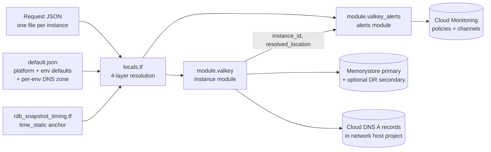
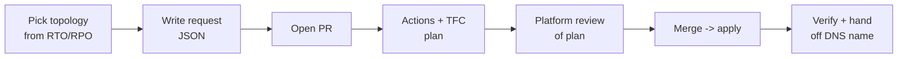
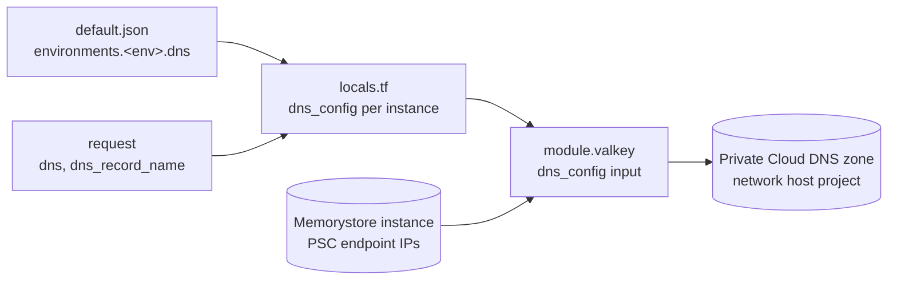

# SOP — GCP Memorystore for Valkey Terraform Platform

Sep 24, 2026 · @Sifu · Updated Sep 27, 2026 (module release history, Cloud DNS A records)

## 1. Purpose, scope and audience

This SOP is the single operating reference for provisioning, changing, troubleshooting and evolving Memorystore for Valkey through the platform Terraform stack. Application teams self-serve by adding one JSON request file; the caching platform team owns everything else.

**In scope**

- Instance module `terraform-google-h4ppy-memorystore-valkey` (current: v2.1.0, which adds optional Cloud DNS A records; previous stable v2.0.2)
- Alerting module `terraform-google-h4ppy-memorystore-valkey-alerts` (current: v1.0.0)
- Onboarding template (root config): `.tf` files, `config/onboarding-files-valkey/*.json`, intake schema
- Cloud DNS A records that map a friendly name to each instance's PSC endpoint IP (section 9)
- GitHub Actions to Terraform Cloud (TFC) pipeline that plans and applies the template

**Out of scope:** data-plane work inside Valkey (key design, TTLs, application code), Shared VPC / service connection policy creation, and creation of the Cloud DNS private managed zones, all of which network engineering owns.

**Responsibilities**

| Activity | App / consumer team | Caching platform team | Network / cloud foundation |
| --- | --- | --- | --- |
| Submit create / change / delete request file | Owns | Reviews PR | — |
| Topology, sizing, persistence defaults | Chooses within allowed fields | Owns `default.json` and module defaults | — |
| Alert recipients (`appteam_emails`) | Owns | Owns `platformteam_emails` | — |
| Maintenance, backups, auth/TLS, PSC | — | Owns | — |
| DNS record opt-out / host label (`dns`, `dns_record_name`) | Chooses | Owns `environments.<env>.dns` in `default.json` | — |
| Cloud DNS managed zone, DNS IAM for the deployer | — | Consumes | Owns |
| Shared VPC, subnets, service connection policy | — | Consumes | Owns |
| Module releases and template changes | — | Owns | — |
| Incident triage and state recovery | Reports | Owns | Supports for network and DNS issues |

**Conventions used here:** `<name>` is the request file's `instance.name`; `<env>` is one of `dev`, `qa`, `uat`, `prod`; the physical GCP instance ID is always `<name>-<env>`.

## 2. Architecture: how the building blocks interact

The stack has four layers: request JSON, the onboarding template, two flat registry modules, and GCP. Each request file becomes one `for_each` key, which drives exactly one instance-module call and one alerts-module call.



The alerts module never reads the request's location; it targets the instance actually created via `module.valkey[key].instance_id` and `.resolved_location`.

The instance module also writes Cloud DNS A records when `dns_config` is passed. It reads the PSC endpoint IPs from the instance it just created, so a record always points at the real endpoint and is updated in the same apply if the IP ever changes.

### Why two modules, not one

Alerting was split out in instance-module v2.0.0. An email-only change now plans only `module.valkey_alerts`, so it does not touch the instance and does not need an infrastructure change ticket. Both modules are flat: no nested submodules, everything readable from the module root. Section 11 has the full release history behind this design.

DNS records stay in the instance module because they depend directly on the instance's endpoint IPs and share its lifecycle: created with the instance, deleted with it.

### Resolution flow in `locals.tf`

1. **Layer 1 — defaults.** `_defaults_raw` loads `default.json`; `_env_infra` selects `environments[var.env]` for project, default region, Shared VPC and DNS zone.
2. **Layer 2 — requests.** Load every `*.json` except `default.json`. Keep files where `environment == var.env` and `request_type != "delete"`. Key by `instance.name`.
3. **Layer 3 — field-by-field merge.** Each module input is `try(request path, default.json path)`. This is deliberate: a shallow `merge()` would drop nested defaults such as `persistence.aof_config` when a request only sets `persistence.mode`. `project_id`, the Shared VPC host and the DNS zone are never taken from a request.
4. **Layer 4 — derivations.** Build `instance_id = <name>-<env>`; derive topology (`DR` if `cross_region_replica`, else `HA` if `replica_count > 0`, else `STANDALONE`); pick `secondary_location` from `dr_region_pairs`; compute a stable `rdb_snapshot_start_time`; assemble labels; build `dns_config`.

### Topologies

| Topology | Trigger in request | What gets created |
| --- | --- | --- |
| STANDALONE | `replica_count: 0`, `cross_region_replica: false` | One primary, no replicas |
| HA | `replica_count >= 1`, `cross_region_replica: false` | One primary with in-region replicas per shard; replication-lag alert on |
| DR | `cross_region_replica: true` | Primary in `location` + SECONDARY instance in the paired region, linked by `cross_instance_replication_config`; an extra `-dr` DNS record when DNS is on |

The secondary is read-only and replicates asynchronously from the primary. It is created only after the primary exists, through its implicit reference to the primary's ID.

### Pipeline

A PR that adds or edits a request file triggers GitHub Actions, which runs a plan in the TFC workspace for that environment. Merge triggers apply. Every run evaluates all request files together as one plan; there is no per-file run.

## 3. File-by-file reference

Every file below has one job; the "Edit when" column tells you which file a given change belongs in.

### Repository layout (onboarding template)

```
.
├── main.tf                  # module "valkey" + module "valkey_alerts", for_each = local.valkey
├── locals.tf                # 4-layer resolution, derivations, guardrail checks, dns_config
├── output.tf                # valkey_instances, derived_topology_by_instance, valkey_dns_records
├── variables.tf             # var.env (dev | qa | uat | prod)
├── provider.tf              # google (pinned 7.39.0) + time providers, TFC backend
├── rdb_snapshot_timing.tf   # time_static.rdb_anchor per instance
├── README.md
├── config/
│   ├── valkey-intake-schema.json      # JSON Schema (Draft-07) for the intake UI
│   └── onboarding-files-valkey/
│       ├── default.json               # platform + per-environment defaults (incl. dns)
│       └── <name>.json                # one per request (test-standalone-cache, test-ha-cache, test-dr-cache)
└── modules/                           # vendored copies until registry sourcing is switched on
    ├── terraform-google-h4ppy-memorystore-valkey/
    └── terraform-google-h4ppy-memorystore-valkey-alerts/
```

### Onboarding template files

| File | What it does | Edit when |
| --- | --- | --- |
| `main.tf` | Calls the instance module and the alerts module once per `local.valkey` key. Passes `enable_replication_lag_alert = replica_count > 0` and `dns_config = each.value.dns_config`. Holds the module `source` / `version` lines. | Switching from vendored path to registry source, or adding a new module input |
| `locals.tf` | Reads `default.json` and request files, merges field by field, derives instance ID, topology, DR region, snapshot time, labels and `dns_config`. Contains the `cross_region_replica_requires_supported_pair` check. | A new request field, a new derivation, or a JSON key rename |
| `output.tf` | `valkey_instances`: per instance, IDs, discovery endpoints, PSC details, DR outputs and nested `alerting`. `derived_topology_by_instance`: debug view of topology, DR region and snapshot time. `valkey_dns_records`: per instance, each record's FQDN and IP. | Exposing a new module output to consumers or Vault |
| `variables.tf` | Only `var.env`, validated to `dev`, `qa`, `uat`, `prod`. | Adding an environment |
| `provider.tf` | Provider versions and TFC backend. Credentials come from the workspace (for example `usr-infra-sa-credentials`). | Provider upgrade, backend change |
| `rdb_snapshot_timing.tf` | One `time_static` per instance so the RDB start time is fixed at creation and never drifts between plans. | Rarely; never delete an anchor for a live instance |
| `config/onboarding-files-valkey/default.json` | Platform defaults and per-environment infrastructure, including the DNS zone (section 4). | Platform default changes, new environment, new DR pair, new DNS zone |
| `config/onboarding-files-valkey/<name>.json` | One self-service request. | Every onboarding, change or decommission |
| `config/valkey-intake-schema.json` | Allowed fields, enums and defaults for the intake UI (including `dns` and `dns_record_name`), plus fields that must never be exposed. | Any time a request field or enum changes |

### Instance module: `terraform-google-h4ppy-memorystore-valkey`

| File | What it does |
| --- | --- |
| `versions.tf` | `required_providers` only (google `< 8.0`). No provider block, so the caller controls project and credentials. |
| `variables.tf` | All inputs and cross-field `check` blocks, evaluated on effective values. Nullable validations use `var.x == null ? true : <check>` (fixed in v2.0.2). Includes `dns_config` (v2.1.0) with a validation that `project`, `managed_zone` and `domain` are all set. |
| `all-locals.tf` | **The** file for module defaults: `local.defaults` map (topology, sizing, persistence, auth/TLS/CA, backups, maintenance, engine config). Effective value = `coalesce(var.x, local.defaults.x)`. Backups default to 03:00 UTC, 35-day retention. |
| `data.tf` | Available regions and zones lookup (region-agnostic validation), project data, Shared VPC network lookup. |
| `main.tf` | `google_memorystore_instance.primary` and optional `google_memorystore_instance.secondary[0]` for DR, declared directly. |
| `dns.tf` | (v2.1.0) Reads PSC endpoint IPs from `endpoints[].connections[].psc_auto_connection[]` on the primary and secondary, decides which records to build from `cluster_mode` and `replica_count`, and creates one `google_dns_record_set` A record per endpoint. Creates nothing when `dns_config` is null or disabled. |
| `outputs.tf` | `instance_id`, `instance_name`, `discovery_endpoints`, `psc_attachment_details`, `psc_connectivity_mode`, `resolved_zone`, `resolved_location`, `secondary_*`, `shared_vpc_network_self_link`, `dns_records` (v2.1.0). |
| `README.md`, `CHANGELOG.md` | Usage, design notes, migration commands per version. |

Auth and TLS are hard-enforced: `authorization_mode` accepts only `IAM_AUTH` and `transit_encryption_mode` only `SERVER_AUTHENTICATION`. `SHARED_CORE_NANO` is blocked when environment is `PROD`.

### Alerts module: `terraform-google-h4ppy-memorystore-valkey-alerts`

| File | What it does |
| --- | --- |
| `versions.tf` | `required_providers` only. |
| `variables.tf` | `project_id`, `instance_id`, `location`; `enable_alerting` (non-nullable, default `true`); `appteam_emails`; `platformteam_emails`; `enable_replication_lag_alert`; check `alerting_requires_appteam_emails`. |
| `alerts.tf` | **The** file for alert behaviour: `local.alert_defaults` (every threshold, duration and metric string, none of them variables) and `local.alert_definitions`. |
| `main.tf` | `google_monitoring_notification_channel.email` (one per unique address) and `google_monitoring_alert_policy.this` (for\_each over definitions). |
| `outputs.tf` | `alerting_enabled`, `notification_channel_ids`, `replication_lag_alert_enabled`, `alert_policy_ids`. |

Alert set: `instance_down`, `cpu_warning`, `cpu_critical`, `memory_warning`, `memory_critical`, `rejected_connections_warning`, `rejected_connections_critical`, `connected_clients_high`, and `replication_lag` when replicas exist.

### Terraform addresses you will use in operations

| Object | Address |
| --- | --- |
| Primary instance | `module.valkey["<name>"].google_memorystore_instance.primary` |
| DR secondary | `module.valkey["<name>"].google_memorystore_instance.secondary[0]` |
| DNS A record | `module.valkey["<name>"].google_dns_record_set.valkey_dns["<key>"]` (keys: `primary-discovery`, `primary-primary`, `primary-reader`, `secondary-*`) |
| Alert policy | `module.valkey_alerts["<name>"].google_monitoring_alert_policy.this["<key>"]` |
| Notification channel | `module.valkey_alerts["<name>"].google_monitoring_notification_channel.email["<email>"]` |
| Snapshot anchor | `time_static.rdb_anchor["<name>"]` |

## 4. Environment-specific configuration

All environment differences live in `default.json`, not in module code. The modules are region- and environment-agnostic; `var.env` selects which `environments.<env>` block and which request files apply.

### `default.json` structure

```json
{
  "type": "valkey-onboarding-defaults",
  "aplication_name": "memorystore-valkey",
  "cluster_mode": "CLUSTER",
  "server_type": "STANDARD_SMALL",
  "shard_count": 1,
  "zone_distribution_mode": "MULTI_ZONE",
  "psc_connectivity_mode": "SHARED_VPC",
  "server_ca_mode": "GOOGLE_MANAGED_PER_INSTANCE_CA",
  "encryption_type": "GOOGLE_MANAGED",
  "persistence": {
    "mode": "RDB",
    "rdb_config": { "rdb_snapshot_period": "TWENTY_FOUR_HOURS" },
    "aof_config": { "append_fsync": "EVERY_SEC" }
  },
  "backup": true,
  "version": "VALKEY_9_0",
  "maintenance_window": { "day_of_week": "SUNDAY", "start_hour": 4, "start_minute": 0 },
  "config": {
    "maxmemory_policy": "volatile-lru",
    "notify_keyspace_events": "KEA",
    "maxmemory_clients": "10%",
    "slowlog_log_slower_than": 5000,
    "maxclients": 5000
  },
  "deletion_protection_enabled": false,
  "platformteam_emails": ["<platform-oncall@company>"],
  "dr_region_pairs": [["us-central1", "us-east4"]],
  "environments": {
    "dev":  { "project_id": "<dev-project>",  "location": "us-central1",
              "networking": { "shared_vpc_host_project": "<npe-host>", "shared_vpc_network_name": "<npe-vpc>" },
              "dns": { "project": "<npe-host>", "managed_zone": "ss-valkey-dev-gcp3-humana-com",
                       "domain": "ss-valkey.dev.gcp3.humana.com", "ttl": 300 } },
    "qa":   { "...": "same shape" },
    "uat":  { "...": "same shape" },
    "prod": { "...": "same shape, prod host project, VPC and DNS zone" }
  }
}
```

`aplication_name` is spelled as the intake wrapper emits it; do not "fix" the key without changing `locals.tf` in the same PR. The same rule applies to the `dns` keys: `locals.tf` reads exactly `project`, `managed_zone`, `domain` and `ttl`.

### Which values come from where

| Setting | Source | Request can override? |
| --- | --- | --- |
| `project_id` | `environments.<env>.project_id` | No |
| Shared VPC host project and network | `environments.<env>.networking` | No |
| DNS zone project, zone name, domain, TTL | `environments.<env>.dns` | No |
| DNS on/off, DNS host label | Request `dns`, `dns_record_name`, else on with label `<name>-<env>` | Yes |
| Primary region (`location`) | Request, else `environments.<env>.location` | Yes |
| DR secondary region | Derived from `dr_region_pairs` using the primary region | No |
| Node type, shard count, replicas | Request, else `default.json` | Yes |
| Persistence mode and nested config | Request, per field, else `default.json` | Yes (partial override is safe) |
| `backup` on/off | Request, else `default.json` | Yes (schedule and retention come from the module) |
| Maintenance window, engine config | Request, per field, else `default.json` | Yes |
| Auth, TLS | Module-enforced | No |
| `platformteam_emails` | `default.json` | No |
| `appteam_emails`, `enable_alerting` | Request | Yes |

### Environment matrix

| Env | `var.env` / TFC workspace | Module `environment` | Notes |
| --- | --- | --- | --- |
| Development | `dev` | `DEV` | `deletion_protection_enabled: false` acceptable |
| QA | `qa` | `QA` | Non-prod network host |
| UAT | `uat` | `UAT` | Mirror prod sizing for realistic tests |
| Production | `prod` | `PROD` | `SHARED_CORE_NANO` blocked; set deletion protection on in the request |

The `_env_label` map in `locals.tf` translates `var.env` to the module's uppercase value. If an environment has no `dns` block, no DNS records are created there.

### Naming and labels

- **Instance ID** is always `<name>-<env>`, for example `orders-cache-dev`. The DR secondary uses the module's secondary suffix.
- **`instance.name` must be unique** across all request files for an environment. Duplicates collide into one `for_each` key and one request silently disappears.
- **DNS name** defaults to `<name>-<env>.<domain>.`, for example `orders-cache-dev.ss-valkey.dev.gcp3.humana.com.`. Section 9 lists the variants.
- **Labels** are assembled automatically: `application_id` (falls back to `aplication_name`), `lob` (omitted if not given), any extra `tags`, plus derived `topology`, `environment` and `managed_by = terraform`. Derived keys always overwrite anything a request sends.

### DR region pairs

Cross-region replication is allowed only between pairs in `dr_region_pairs`, today `us-central1 <-> us-east4`. Pairs are stored once and expanded in both directions in `locals.tf`. A DR request from an unlisted region fails plan with a clear error. To add a pair, the platform team edits `default.json` only; no code change.

## 5. Prerequisites (one-time per environment)

Four things must exist before the first request in an environment: enabled APIs, a correctly permissioned deployer identity, a service connection policy on the Shared VPC, and (if DNS records are wanted) a private Cloud DNS zone the deployer can write to. Terraform does not create any of them.

### APIs

| API | Project | Why |
| --- | --- | --- |
| `memorystore.googleapis.com` | Valkey project | Create and manage instances |
| `compute.googleapis.com` | Valkey project, network host | Network and region lookups |
| `networkconnectivity.googleapis.com` | Network host | Service connection policy, PSC |
| `serviceconsumermanagement.googleapis.com` | Valkey project | PSC consumer side |
| `monitoring.googleapis.com` | Valkey project | Alert policies, notification channels |
| `dns.googleapis.com` | Network host (DNS zone project) | A records |

```bash
gcloud services enable memorystore.googleapis.com compute.googleapis.com \
  networkconnectivity.googleapis.com serviceconsumermanagement.googleapis.com \
  monitoring.googleapis.com --project=<valkey-project>
```

### Deployer identity (TFC workspace service account)

| Role | Scope | Why |
| --- | --- | --- |
| `roles/memorystore.admin` | Valkey project | `memorystore.instances.create` and updates |
| `roles/monitoring.alertPolicyEditor` | Valkey project | Alert policies |
| `roles/monitoring.notificationChannelEditor` | Valkey project | Email channels |
| `roles/compute.networkViewer` (or `compute.networks.get`) | Network host project | `data.google_compute_network` lookup |
| `roles/dns.admin`, or a custom "DNS Editor" role with the permissions below | Network host project, or the single managed zone | Create, update and delete A records |
| Limited `roles/resourcemanager.projectIamAdmin` (conditioned to `dbConnectionUser` only) | Valkey project | Only if Terraform grants consumer connect access |

Permissions a custom DNS role must include for `google_dns_record_set`:

```
dns.managedZones.get
dns.managedZones.list
dns.resourceRecordSets.create
dns.resourceRecordSets.get
dns.resourceRecordSets.list
dns.resourceRecordSets.update
dns.resourceRecordSets.delete
dns.changes.create
dns.changes.get
```

The DNS grant must go to the **workspace service account**, not only to an engineer's user account. A user's DNS access helps only for local applies run with that user's credentials.

Prefer Workload Identity Federation for the pipeline over a downloaded key. If any step shells out to `gcloud`, confirm `gcloud config list` shows the same identity the provider uses.

### Networking

- The Valkey project is a Shared VPC service project attached to the environment's host project.
- A **service connection policy** for service class `gcp-memorystore` must exist on the Shared VPC network in each region you deploy to, including the DR region. The module references it but cannot validate it at plan time; a missing policy fails only at apply.
- For DNS, a **private managed zone** must exist in the network host project and be attached to the Shared VPC network clients use. Get the zone **name** (for example `ss-valkey-dev-gcp3-humana-com`) and its **DNS suffix** (for example `ss-valkey.dev.gcp3.humana.com`) from the network team; they are different values.

```bash
gcloud network-connectivity service-connection-policies list \
  --project=<network-host-project> --region=<region>

gcloud dns managed-zones list --project=<network-host-project>
```

Test DNS permissions once with a throwaway record before the first apply:

```bash
gcloud dns record-sets create tf-perm-test.<dns-suffix>. \
  --zone=<zone-name> --type=A --ttl=60 --rrdatas=10.255.255.1 \
  --project=<network-host-project>

gcloud dns record-sets delete tf-perm-test.<dns-suffix>. \
  --zone=<zone-name> --type=A --project=<network-host-project>
```

If `delete` is denied, creates will work but later IP changes and decommissions will fail. Get the delete permission added first.

### Onboarding checklist for a new environment

- [ ] APIs enabled in Valkey and host projects
- [ ] Deployer SA roles granted and propagated (allow about 2 minutes), including DNS on the host project or zone
- [ ] Service connection policy present in primary and DR regions
- [ ] Private DNS zone exists, is attached to the Shared VPC, and the throwaway-record test passes
- [ ] `environments.<env>` block added to `default.json` with host project, network name and `dns` block
- [ ] TFC workspace created with `env` variable and credentials
- [ ] Smoke test: STANDALONE request in the new environment applies, resolves by DNS name and connects

## 6. Self-service provisioning procedure

A new instance is one new JSON file in `config/onboarding-files-valkey/`, merged through a reviewed PR. No `.tf` edits and no manual Terraform commands.



### Step 1 — Choose topology and size

| Need | Choose |
| --- | --- |
| Test / disposable cache, loss acceptable | STANDALONE, `replica_count: 0` |
| In-region failover, zone loss tolerated | HA, `replica_count: 1` or more |
| Regional outage tolerated (cross-region RPO) | DR, `cross_region_replica: true`, primary in a paired region |
| Data must survive restart | `persistence.mode: RDB` (periodic) or `AOF` (every-second fsync) |
| Capacity-bound workload | `highmem` node family has the lowest cost per GB |

### Step 2 — Create the request file

File name: `config/onboarding-files-valkey/<name>.json`. Example (DR):

```json
{
  "type": "instance",
  "request_type": "create",
  "environment": "dev",
  "requested_by": "orders-team",
  "instance": {
    "name": "orders-cache",
    "shard_count": 1,
    "replica_count": 1,
    "server_type": "STANDARD_SMALL",
    "version": "VALKEY_9_0",
    "location": "us-central1",
    "cross_region_replica": true,
    "persistence": { "mode": "RDB" },
    "backup": true,
    "application_id": "orders-api",
    "lob": "cc-0003",
    "tags": { "team": "orders" },
    "enable_alerting": true,
    "appteam_emails": ["orders-oncall@company"],
    "dns": true,
    "dns_record_name": "orders-cache"
  }
}
```

Rules:

- `environment` must equal the target `var.env`; files for other environments are ignored in that run.
- `name` is unique per environment; do not include the env suffix yourself.
- `appteam_emails` must be non-empty while alerting is on (the default).
- `dns` defaults to `true` when the environment has a DNS zone. `dns_record_name` is optional; omit it to get `<name>-<env>`.
- Omit any field to inherit `default.json`. Never set `project_id`, network, DNS zone or auth fields.
- Validate the file against `config/valkey-intake-schema.json` before raising the PR.

### Step 3 — Open the PR and review the plan

Reviewer (platform team) confirms in the TFC plan:

- [ ] Only `module.valkey["<name>"]`, `module.valkey_alerts["<name>"]` and `time_static.rdb_anchor["<name>"]` are **created**
- [ ] DNS records appear as `google_dns_record_set.valkey_dns[...]` under `module.valkey["<name>"]`, with the expected name and `managed_zone` (the IP shows as known after apply)
- [ ] Zero changes or destroys on any other key
- [ ] Instance ID is `<name>-<env>`; region and DR region are as expected (`derived_topology_by_instance` output helps)
- [ ] Node type is not `SHARED_CORE_NANO` in prod; deletion protection on in prod
- [ ] No check-block warnings in the plan output

### Step 4 — Merge and apply

Merging triggers apply in TFC. DR applies take longest: the primary must be ready before the secondary starts. DNS records are written after the instance they point at is created.

### Step 5 — Verify and hand off

```bash
gcloud memorystore instances describe <name>-<env> \
  --location=<region> --project=<project> \
  --format="yaml(state,endpoints,pscAutoConnections)"

terraform output valkey_dns_records
dig +short <record-fqdn>        # from a VM in the Shared VPC
```

- `state` is `ACTIVE` for the primary and, for DR, the secondary. Do not rely on a clean `terraform plan` to prove health.
- The DNS name resolves to the same IP as the instance's discovery (or primary) endpoint.
- Endpoints appear in `valkey_instances["<name>"].discovery_endpoints` and `psc_attachment_details` outputs.
- Send a test notification from Cloud Monitoring to confirm email channels.
- Grant consumer connect access (section 8) and share the DNS name plus port `6379`.

## 7. Configuration changes and decommissioning

Every change is an edit to the request file (or to `default.json` for platform-wide defaults), reviewed through the same PR flow. The table shows the blast radius and change class before you raise the PR.

### Change matrix

| Change | Edit | Plans | Change class |
| --- | --- | --- | --- |
| Add / remove alert recipient | `appteam_emails` in request | `module.valkey_alerts` only | Standard, no infra ticket |
| Turn alerting off / on | `enable_alerting` | `module.valkey_alerts` only | Standard |
| Turn DNS record off / on | `dns` | DNS record set only | Standard, but tell consumers first |
| Change DNS host label | `dns_record_name` | DNS record replaced (old name removed) | Standard, coordinate cutover with consumers |
| Scale shards | `shard_count` | Instance, in place | Infra change |
| Scale replicas (STANDALONE <-> HA) | `replica_count` | Instance, in place; lag alert toggles; `-ro` record added/removed in `CLUSTER_DISABLED` | Infra change |
| Engine config (`maxmemory_policy`, `maxclients`...) | `config.*` | Instance, in place | Infra change |
| Maintenance window | `maintenance_window.*` | Instance, in place | Infra change |
| Persistence mode | `persistence.mode` | Instance; check plan for replace | Infra change, review carefully |
| Add labels | `application_id`, `lob`, `tags` | Instance, in place | Standard |
| Change region, add DR, rename | `location`, `cross_region_replica`, `name` | **Destroy and recreate** (DNS record follows) | Infra change + data migration plan |
| DNS zone, domain or TTL for an environment | `environments.<env>.dns` in `default.json` | Every DNS record in that environment | Platform change, notify teams |
| Platform default for all instances | `default.json` | Every instance that inherits it | Platform change, notify teams |
| Alert thresholds | Alerts module `alerts.tf` + new release | All alert policies | Platform release |

### Procedure for an in-place change

1. Edit only the fields you need in `<name>.json`.
2. Open a PR. Confirm the plan shows `~ update in-place` for your key only, and no `-/+` replace.
3. **Change one instance field per apply.** The Memorystore update API accepts one field per request (`Error 400: exactly 1 update_mask field`). Split multi-field changes into sequential PRs. DNS fields are separate resources and do not count against this limit.
4. Order for scaling: shrink replicas before shards; grow shards before replicas.
5. Merge, apply, then verify `state: ACTIVE` with `gcloud`.

### Decommission one instance

Set `"request_type": "delete"` in the request file and merge. The key drops out of `local.valkey`, and the plan destroys only that instance, its DNS records, its alerts and its snapshot anchor.

- If deletion protection is on, first apply a change setting `deletion_protection_enabled: false`, then apply the delete.
- Keep the file with `request_type: delete` as an audit record; remove it in a later cleanup PR.
- Do **not** use `terraform destroy -target` for this. The file still declares the instance, so the next normal apply recreates it.

### Never do

- Run `terraform destroy` on an environment workspace; it removes every instance in that environment.
- Edit instances or their DNS records in the console; the next apply reverts or conflicts with the change.
- Reuse a `name` from another request file.

## 8. Consumer access and connectivity

Every instance uses IAM authentication and TLS, so a client needs both a network path and an IAM grant. Neither admin nor editor roles include connect permission.

### Access roles

| Role | Grants | Typical grantee |
| --- | --- | --- |
| `roles/memorystore.dbConnectionUser` | `memorystore.instances.connect` (authenticate with an IAM token) | Application service account |
| `roles/memorystore.viewer` | Read instance metadata, endpoints, PSC config | App team group |

Both roles apply project-wide by default. Scope them to one instance with an IAM condition:

```
resource.name == "projects/<project>/locations/<region>/instances/<name>-<env>"
```

### Connecting

1. The client runs in a service project attached to the same Shared VPC, in a subnet that reaches the PSC endpoint.
2. Use the DNS name from `valkey_dns_records` (preferred) or the raw IP from `valkey_instances["<name>"].discovery_endpoints`. The port is always passed separately (`6379`); DNS holds only the IP.
3. Download the instance's server CA and connect with TLS, passing the service account's access token as the password.
4. Smoke test with `PING`, then a `SET` / `GET` of a test key.

```bash
valkey-cli -h orders-cache-dev.ss-valkey.dev.gcp3.humana.com -p 6379 -c \
  --tls --cacert server-ca.pem PING
```

### Limits to communicate to consumers

- **TLS hostname check.** The server certificate is issued for the instance's endpoints, not for the custom DNS name. Clients that verify the hostname may reject a connection made by DNS name. Configure the client to verify the CA but skip the hostname check, and test this early.
- **Cluster mode uses DNS for the first connect only.** In `CLUSTER` mode the record points at the discovery endpoint; after connecting, clients follow `MOVED` redirects to node IPs.
- **No per-user command ACLs via Terraform.** The provider exposes ACL policies only as a data source. Any `gcloud`-based ACL policy is outside Terraform state and must be tracked separately.
- Two principals with `dbConnectionUser` on the same instance have the same command access. Real read / write separation needs separate instances or a proxy layer.
- There is no "create database" step. Teams namespace keys by convention (for example `orders:<id>`).

## 9. Cloud DNS A records for instance endpoints

Each instance can get a stable, friendly DNS name that points at its PSC endpoint IP, so consumers never hard-code an IP. The network team owns the private zone; the instance module writes the records into it; the zone details are hard-coded per environment in `default.json`. Added in instance module v2.1.0 (September 2026). Existing instances are not replaced when this is switched on; the plan only adds `google_dns_record_set` resources.

### How it works



1. `default.json` holds the zone project, zone name, domain and TTL per environment.
2. `locals.tf` builds `dns_config` inside `_valkey_raw` for each request. Zone details come only from `default.json`; a request can only opt out or change the host label.
3. The module reads the endpoint IPs from the created instance and writes one A record per endpoint.

### Records created

The `for_each` keys are fixed from `cluster_mode` and `replica_count`, so they are known at plan time even for a new instance; only the IPs resolve at apply.

| Mode | Record | Points at |
| --- | --- | --- |
| `CLUSTER` (platform default) | `<host>.<domain>.` | `CONNECTION_TYPE_DISCOVERY` IP |
| `CLUSTER_DISABLED` | `<host>.<domain>.` | `CONNECTION_TYPE_PRIMARY` IP (read/write) |
| `CLUSTER_DISABLED` with replicas | `<host>-ro.<domain>.` | `CONNECTION_TYPE_READER` IP (read-only) |
| DR (adds) | `<host>-dr.<domain>.` (and `-dr-ro` when cluster-disabled) | Secondary instance's IPs |

`<host>` is `dns_record_name` if set, else the instance ID `<name>-<env>`. Because the environment is usually already in the domain, a request can set `"dns_record_name": "<name>"` for a shorter name.

### Worked example

Zone name `ss-valkey-dev-gcp3-humana-com`, DNS name `ss-valkey.dev.gcp3.humana.com.`, request `test-ha-cache` in dev, `CLUSTER` mode, discovery IP `10.100.1.23`:

```hcl
valkey_dns_records = {
  "test-ha-cache" = {
    "primary-discovery" = {
      "fqdn" = "test-ha-cache-dev.ss-valkey.dev.gcp3.humana.com."
      "ip"   = "10.100.1.23"
    }
  }
}
```

| Name | Type | TTL | Data |
| --- | --- | --- | --- |
| `test-ha-cache-dev.ss-valkey.dev.gcp3.humana.com.` | A | 300 | `10.100.1.23` |

The trailing dot is normal; Cloud DNS stores fully qualified names. The zone *name* never appears in the record; it only tells Terraform which zone to write into. A trailing dot on `domain` in `default.json` is also fine: the module strips it with `trimsuffix` and adds exactly one.

### Code reference

**Module `variables.tf`**

```hcl
variable "dns_config" {
  description = "Optional Cloud DNS A records for the instance's PSC endpoint(s). null = no records."
  type = object({
    enabled      = optional(bool, true)
    project      = string            # project that owns the managed zone
    managed_zone = string            # zone NAME, not the DNS suffix
    domain       = string            # zone DNS suffix; trailing dot optional
    record_name  = optional(string)  # host label; defaults to instance_id
    ttl          = optional(number, 300)
  })
  default = null

  validation {
    condition = var.dns_config == null || alltrue([
      for k in ["project", "managed_zone", "domain"] :
      try(length(trimspace(var.dns_config[k])) > 0, false)
    ])
    error_message = "dns_config.project, managed_zone and domain must all be set (check default.json environments.<env>.dns)."
  }
}
```

Keep `project`, `managed_zone` and `domain` required (not `optional`). A missing value must fail at the module call, not surface later as a confusing resource error.

**Module `dns.tf`**

```hcl
locals {
  dns_enabled = var.dns_config != null && try(var.dns_config.enabled, true)
  dns_domain  = local.dns_enabled ? trimsuffix(var.dns_config.domain, ".") : ""
  dns_host    = local.dns_enabled ? coalesce(var.dns_config.record_name, var.instance_id) : ""

  dns_endpoint_types = var.cluster_mode == "CLUSTER" ? {
    discovery = { suffix = "", type = "CONNECTION_TYPE_DISCOVERY" }
    } : merge(
    { primary = { suffix = "", type = "CONNECTION_TYPE_PRIMARY" } },
    var.replica_count > 0 ? { reader = { suffix = "-ro", type = "CONNECTION_TYPE_READER" } } : {}
  )

  # discovery_endpoints / psc_auto_connections are deprecated and stay empty when
  # endpoints are auto-created from the service connection policy, so read endpoints[].
  primary_psc_ips = {
    for c in flatten([
      for ep in google_memorystore_instance.primary.endpoints : [
        for conn in ep.connections : conn.psc_auto_connection
      ]
    ]) : c.connection_type => c.ip_address
  }

  secondary_psc_ips = local.enable_cross_region_replication ? {
    for c in flatten([
      for ep in google_memorystore_instance.secondary[0].endpoints : [
        for conn in ep.connections : conn.psc_auto_connection
      ]
    ]) : c.connection_type => c.ip_address
  } : {}

  dns_records = !local.dns_enabled ? {} : merge(
    {
      for k, v in local.dns_endpoint_types : "primary-${k}" => {
        name = "${local.dns_host}${v.suffix}.${local.dns_domain}."
        ip   = local.primary_psc_ips[v.type]
      }
    },
    local.enable_cross_region_replication ? {
      for k, v in local.dns_endpoint_types : "secondary-${k}" => {
        name = "${local.dns_host}-dr${v.suffix}.${local.dns_domain}."
        ip   = local.secondary_psc_ips[v.type]
      }
    } : {}
  )
}

resource "google_dns_record_set" "valkey_dns" {
  for_each = local.dns_records

  project      = var.dns_config.project
  managed_zone = var.dns_config.managed_zone
  name         = each.value.name
  type         = "A"
  ttl          = var.dns_config.ttl
  rrdatas      = [each.value.ip]
}
```

If an expected endpoint type is missing, the map lookup fails the apply with a clear error instead of silently skipping a record. That is intentional.

**Module `outputs.tf`**

```hcl
output "dns_records" {
  description = "A records created for this instance: key => { fqdn, ip }."
  value = {
    for k, r in google_dns_record_set.valkey_dns : k => {
      fqdn = r.name
      ip   = r.rrdatas[0]
    }
  }
}
```

**Template `locals.tf`** — inside `_valkey_raw = { for name, payload in local._request_instance : name => { ... } }`, because `payload` is only in scope there. `_env_infra` is `local._defaults_raw.environments[var.env]`.

```hcl
    dns_config = try(local._env_infra.dns, null) == null ? null : {
      enabled      = try(tobool(payload.instance.dns), true)
      project      = local._env_infra.dns.project
      managed_zone = local._env_infra.dns.managed_zone
      domain       = local._env_infra.dns.domain
      ttl          = try(local._env_infra.dns.ttl, 300)
      record_name  = try(payload.instance.dns_record_name, null)
    }
```

Only the outer `dns` presence check and the optional fields use `try()`. The zone fields are read directly, so a key typo fails loudly instead of becoming `null`. If a later local rebuilds the final map field by field instead of using `merge(v, {...})`, add `dns_config = v.dns_config` there too.

**Template `main.tf`** (one new line)

```hcl
module "valkey" {
  # ...existing arguments...
  dns_config = each.value.dns_config
}
```

**Template `output.tf`**

```hcl
output "valkey_dns_records" {
  value = { for name, m in module.valkey : name => m.dns_records }
}
```

**Intake schema** (`config/valkey-intake-schema.json`, under `instance`)

```json
"dns": { "type": "boolean", "default": true },
"dns_record_name": { "type": "string", "pattern": "^[a-z0-9]([a-z0-9-]{0,61}[a-z0-9])?$" }
```

### Verify before planning

```bash
terraform console -var="env=dev"
> local._env_infra.dns
> local._valkey_raw["<name>"].dns_config
```

The first prints the environment's zone details; the second prints the full `dns_config` with `enabled = true`. If the first shows `managed_zone` and the second shows `null`, the problem is in `locals.tf`; if the first does not show it, the problem is in `default.json`.

### Manual fallback (no Terraform)

Only for a one-off while the pipeline is unavailable; the record is outside state and must be deleted before Terraform takes over that name.

```bash
gcloud dns record-sets create <host>.<dns-suffix>. \
  --zone=<zone-name> --type=A --ttl=300 \
  --rrdatas=<psc-ip> --project=<network-host-project>
```

## 10. Troubleshooting runbook

Start with the error text, find its row, and apply the fix; every row below was hit in real deployments of this stack. Always run a plan after a fix and before an apply.

### Known errors

| Symptom | Cause | Fix |
| --- | --- | --- |
| `403 permission memorystore.instances.create denied` | Deployer SA lacks `roles/memorystore.admin`, or wrong project | Grant the role on the Valkey project; wait about 2 minutes; confirm with `gcloud projects get-iam-policy` |
| `project: required field is not set` on `data.google_compute_network.shared_vpc_net`, with a check warning `shared_vpc_host_project is null` | Key name mismatch between `default.json` networking block and `locals.tf` | `locals.tf` reads `networking.shared_vpc_host_project`; make the JSON key match exactly |
| `google_dns_record_set` error: `managed_zone` is null / required field not set | Key name mismatch between `default.json` `dns` block and `locals.tf` (seen: `locals.tf` read `dns.dns_managed_zone` while JSON had `managed_zone`), hidden by a `try(..., null)` | Read `local._env_infra.dns.managed_zone` directly, with no `try()`; confirm with `terraform console` (section 9) |
| Plan fails: `dns_config.project, managed_zone and domain must all be set` | `dns` block incomplete for this environment | Complete `environments.<env>.dns` in `default.json` |
| DNS record create or delete returns `403` | Workspace SA lacks DNS permissions on the host project or zone (a user's own "DNS Editor" access does not apply to pipeline runs) | Grant `roles/dns.admin` or the custom role with the permissions in section 5 to the SA |
| Apply fails on a missing map key in `dns.tf` | Expected endpoint type not present (for example, no PSC endpoint yet) | Fix the endpoint (usually the service connection policy), then re-apply |
| Client TLS error when connecting by DNS name | Certificate does not include the custom name | Verify the CA only, skip the hostname check in the client |
| Red squiggle on `dns_config` in VS Code, but `terraform validate` passes | Editor extension using a stale cached module copy | Ignore; run `terraform init -upgrade` or reload the window |
| "Values for undeclared variables" warnings above an error | TFC workspace variables the template does not declare | Harmless; not the cause of the error below them |
| `An argument named "X" is not expected here` at init | Vendored module copy is older than the template | Re-copy the module version the template expects, or pin the registry version |
| `Unsupported argument` for `enable_alerting` on `module.valkey` | Template still wired for the pre-2.0.0 merged module | Move alert inputs to `module.valkey_alerts` |
| `Unsupported argument` for `dns_config` on `module.valkey` | Module older than v2.1.0 | Pin `version = "~> 2.1"` and run `terraform init -upgrade` |
| Plan fails: `appteam_emails` required | Alerting on with empty list | Add at least one address, or set `enable_alerting: false` |
| Plan fails: unsupported DR pair | DR requested from a region not in `dr_region_pairs` | Use a paired primary region, or ask the platform team to add a pair |
| Validation error on `AUTH_DISABLED` / `TRANSIT_ENCRYPTION_DISABLED` | Module v2.0.1+ enforces IAM auth and TLS | Remove the override |
| `argument must not be null` on an optional input | Null-unsafe validation in module < 2.0.2 | Upgrade to v2.0.2 or later |
| `persistence_config cannot be different from the primary instance` | DR primary and secondary got different snapshot start times | Handled by `time_static` anchor and `persistence_config_consistency` check; do not set the start time to null for DR |
| `Error 400: exactly 1 update_mask field` | Several instance fields changed in one apply | Split into sequential applies, one field each |
| Apply succeeds but no PSC endpoint | Service connection policy missing in that region | Create the policy (network team), re-apply |
| One request's instance missing from plan | Duplicate `instance.name` across two files | Rename one file's `name` |
| Instance destroyed by a `-target` destroy comes back | Request file still declares it | Use `request_type: delete` instead |
| Git push rejected, CI runs old code | Local branch behind remote | `git pull --rebase`, push again, re-run the plan |

### Recovery: DR secondary fails with RESOURCE\_EXHAUSTED, then 409

**What happened.** The primary was created; the secondary create hit `code 8 RESOURCE_EXHAUSTED` (no capacity in the region). GCP left a partial secondary, but Terraform never recorded it. The next apply returns `409 already exists`, or after an import shows "no changes" although the console shows the secondary as failed. Plan compares configuration, not health.

**Do not** add `depends_on` or `time_sleep`. Ordering is already implicit, and capacity is not a timing problem.

Recommended fix (no CI change required):

1. Confirm the primary is healthy:

```bash
gcloud memorystore instances describe <name>-<env> --location=<region> --project=<project> --format="value(state)"
```

2. Delete the failed secondary outside Terraform:

```bash
gcloud memorystore instances delete <secondary-instance-id> --location=<dr-region> --project=<project>
```

3. Remove it from the TFC remote state (authenticated with `terraform login`, in the workspace):

```bash
terraform state rm 'module.valkey["<name>"].google_memorystore_instance.secondary[0]'
```

4. Re-run the normal pipeline. The secondary is created fresh like any first-time create, and its `-dr` DNS record follows.

Alternatives:

- If the secondary is healthy and only missing from state: `terraform import` it to the same address, then review the plan.
- If the resource must be recreated while still in state: a TFC run with replace-addresses set to the secondary's address (the equivalent of `-replace`). Use it only as a one-off manual run.

To reduce recurrence: retry the apply step in the workflow with backoff (for example 60s, 120s, 180s); for chronically tight regions, pin `SINGLE_ZONE` with an explicit zone or choose another paired region.

### Useful diagnostics

```bash
terraform state list | grep '<name>'
terraform output derived_topology_by_instance
terraform output valkey_dns_records
gcloud memorystore instances list --location=<region> --project=<project>
gcloud network-connectivity service-connection-policies list --project=<host> --region=<region>
gcloud dns record-sets list --zone=<zone-name> --project=<host> --filter="type=A"
gcloud logging read 'resource.type="memorystore.googleapis.com/Instance"' --project=<project> --limit=50
```

### Escalation

| Level | Who | When |
| --- | --- | --- |
| L1 | App team | Request-file errors, missing emails, schema validation |
| L2 | Caching platform team | Plan/apply failures, state recovery, module bugs, DNS key mismatches |
| L3 | Network team / Google support | Missing SCP, PSC failures, DNS zone or DNS IAM, persistent capacity exhaustion |

## 11. Continuous enhancement

Modules evolve through semantic-versioned releases to the TFC private registry; the template adopts a new version through a normal PR. Put each change in the layer that owns it.

### Where a change belongs

| Change | Layer | Release needed |
| --- | --- | --- |
| New default value (node type, backup on/off) | `default.json` | No, template PR |
| New DNS zone or TTL for an environment | `default.json` `environments.<env>.dns` | No, template PR |
| New module-wide default or allow-list | Instance module `all-locals.tf` | Yes, minor |
| New input variable or output | Instance module `variables.tf` / `outputs.tf`, then template `main.tf` / `output.tf` | Yes, minor |
| Alert threshold or new alert | Alerts module `alerts.tf` | Yes, minor |
| Removed or renamed input, resource address change | Module | Yes, **major**, with migration notes |
| New request field | Template `locals.tf` + intake schema | No |

### Release procedure (module repo)

1. Branch, change code, update `README.md` and `CHANGELOG.md` (Keep a Changelog format).
2. `terraform fmt -recursive` and `terraform validate`; plan against a dev workspace using the branch as source.
3. PR review by a second platform engineer.
4. Merge, then tag with an annotated tag and push it:

```bash
git checkout main && git pull origin main
git fetch --tags
git tag --sort=-v:refname | head -5      # confirm the latest existing tag

git tag -a v2.1.0 -m "v2.1.0: <summary>"
git push origin v2.1.0

# optional GitHub Release page
gh release create v2.1.0 --title "v2.1.0" --notes "<summary>"
```

5. TFC publishes the tag as a registry version automatically. Repo names must stay `terraform-google-<name>` and tags must use the `v` prefix.
6. Template PR: bump `version` in `main.tf`, run plans in every environment, promote dev -> qa -> uat -> prod.

**Tag rules**

- Tags are immutable. Never force-move a published tag; registries may keep serving the first snapshot, and anyone who already fetched it ends up with a diverged tag. Fix forward with a new patch version.
- A tag pushed by mistake and not yet consumed can be removed: `git tag -d vX.Y.Z && git push origin :refs/tags/vX.Y.Z`.
- Pre-release tags (for example `v2.0.1-pre`) are not matched by `~>` constraints. Pin them exactly (`= 2.0.1-pre`) while testing, and check that the registry's tag pattern accepts a `-suffix` at all.

### Switching the template to registry sources

```hcl
module "valkey" {
  source  = "app.terraform.io/<ORG>/h4ppy-memorystore-valkey/google"
  version = "~> 2.1"   # 2.1 is the first version with dns_config
  # ...
}
```

Once switched, delete the vendored `modules/` directory in the same PR so there is one source of truth.

### Breaking-change rules

- Resource address changes ship with `moved` blocks or exact `terraform state mv` commands in the changelog.
- Run the plan in every environment before merging; any unexpected `-/+` on a live instance blocks the release.
- Output name changes need the template's `output.tf` updated in the same PR; diff module output names against root exports.

### Module release history

Every version released so far, oldest first, with the reason it was cut. The instance module was first published as `terraform-google-valkey` and later renamed with the `h4ppy-memorystore` prefix; the version line continued unchanged.

**Instance module (`terraform-google-h4ppy-memorystore-valkey`)**

| Version | Date | Type | What changed | Why |
| --- | --- | --- | --- | --- |
| 1.0.0 | 2026-07-30 | First release | Consolidated the two internal, unpublished modules (`memorystore-valkey` and `valkey-alerting`) into one module with `_instance` and `_alert_policy` submodules. `deployment_topology` (`STANDALONE` / `HA` / `DR`) became the single source of truth, enforced by `check` blocks. All defaults moved into root `all-locals.tf`. | Publish one module to the registry for the template to consume, and make every default editable in a single file. Published as 1.0.0 because the merge happened before anything was ever tagged. |
| 2.0.0 | 2026-08-03 | Major (breaking) | Alerting removed (moved to the new alerts module). Submodules flattened: `module.primary` became `google_memorystore_instance.primary`, `module.secondary[0]` became `google_memorystore_instance.secondary[0]`, with `terraform state mv` commands in the changelog. Added `resolved_location` output. | An email-list change had to plan against the instance, so it went through the infrastructure change-ticket process. Separating alerting lets recipients change on their own. Registry modules should be flat, with everything readable from the root. |
| 2.0.1-pre | 2026-08-04 | Pre-release | `authorization_mode` accepts only `IAM_AUTH`; `transit_encryption_mode` accepts only `SERVER_AUTHENTICATION`. `AUTH_DISABLED` and `TRANSIT_ENCRYPTION_DISABLED` are rejected. | Every instance must require client authentication and in-transit encryption, with no opt-out. Drafted as 3.0.0 and deliberately tagged `2.0.1-pre` instead; the changelog notes this is breaking behaviour under strict semver, so treat it like a major when deciding to upgrade. Superseded by 2.0.2 (see below) and a candidate for deletion. |
| 2.0.2 | 2026-08 | Patch | Null-safe validations across 23 blocks (`var.x == null \|\| ...` rewritten to `var.x == null ? true : ...`). No interface change. | 2.0.1-pre failed with `argument must not be null` on optional inputs, because Terraform evaluates both sides of `\|\|`. Cut as a new tag instead of moving `v2.0.1-pre`, since tags are immutable. |
| 2.1.0 | 2026-09-25 | Minor | New optional `dns_config` input, `dns.tf` and `dns_records` output: Cloud DNS A records for the PSC endpoints (discovery, or primary/reader, plus `-dr` for DR). Validation that zone fields are set. | Network team provided a private DNS zone; consumers need a stable name instead of a raw IP. Non-breaking because `dns_config` defaults to `null`. |

**Alerts module (`terraform-google-h4ppy-memorystore-valkey-alerts`)**

| Version | Date | Type | What changed | Why |
| --- | --- | --- | --- | --- |
| 1.0.0 | 2026-08-03 | First release | Standalone module with `google_monitoring_alert_policy` (for_each over `alert_definitions`) and one `google_monitoring_notification_channel` per unique email. Fixed alert set carried over unchanged. New `enable_replication_lag_alert` input. | Extracted alongside instance module 2.0.0 so email changes never touch the instance. The caller passes `replica_count > 0` for the lag alert because this module cannot see the instance's replica count. |

**Template milestones (not versioned as a module)**

| Tag | What changed |
| --- | --- |
| `onboarding-dr-pairing-2026-08` | Env-suffixed instance IDs, instance-level `application_id` / `lob` labels, DR auto-pairing via `dr_region_pairs`, `prd` renamed to `prod` |
| (Sep 2026) | `dns` block per environment in `default.json`, `dns_config` in `locals.tf`, `valkey_dns_records` output, intake schema fields `dns` and `dns_record_name` |

### Enhancement backlog

- [ ] Publish both modules to the private registry and switch template sources
- [ ] Delete the superseded `v2.0.1-pre` tag once no workspace pins it
- [ ] Add apply-retry with backoff to the GitHub Actions workflow
- [ ] CI check: fail on duplicate `instance.name` and schema-invalid request files
- [ ] Reshape outputs into a client connection string (DNS name + port + CA) and write to HashiCorp Vault
- [ ] Instance-scoped `dbConnectionUser` / `viewer` grants for consumer groups
- [ ] Promotion path for QA/UAT instances to production
- [ ] Intake wrapper that derives topology and persistence from RTO/RPO, workload type and payload size
- [ ] Decide whether DR secondaries should get automated backups (currently none)
- [ ] Decide on a DR failover DNS pattern (for example a stable alias that is repointed to `-dr` on failover)
- [ ] Native ACL policy resource once the Google provider supports it

## 12. Appendix

### A. Request-file field reference (`instance.*`)

| Field | Type | Default source | Notes |
| --- | --- | --- | --- |
| `name` | string | required | Unique per environment; instance ID becomes `<name>-<env>` |
| `location` | region | `environments.<env>.location` | Must be a paired region if DR |
| `shard_count` | int | `default.json` |  |
| `replica_count` | int | module default | `> 0` makes HA and enables the lag alert |
| `server_type` | node type | `default.json` | `SHARED_CORE_NANO` not allowed in prod |
| `version` | engine | `default.json` | For example `VALKEY_9_0` |
| `cross_region_replica` | bool | `false` | `true` makes DR |
| `persistence.mode` | `RDB` / `AOF` / `DISABLED` | `default.json` | Nested fields merge individually |
| `backup` | bool | `default.json` | Schedule 03:00 UTC, 35-day retention from module |
| `maintenance_window.*` | object | `default.json` | `day_of_week`, `start_hour` |
| `config.*` | object | `default.json` | `maxmemory_policy`, `maxclients`, etc. |
| `deletion_protection_enabled` | bool | `default.json` | Set `true` for prod |
| `application_id` | string | `aplication_name` | Always labelled |
| `lob` | string | none | Labelled when present |
| `tags` | map | `{}` | Extra labels; reserved keys overwritten |
| `enable_alerting` | bool | `true` |  |
| `appteam_emails` | list | `[]` | Required when alerting is on |
| `dns` | bool | `true` (when the env has a DNS zone) | `false` skips DNS records for this instance |
| `dns_record_name` | string | `<name>-<env>` | Host label only, lowercase DNS label; zone and domain always come from `default.json` |

Top-level keys: `type`, `request_type` (`create` / `delete`), `environment`, `requested_by`.

### B. Guardrail checks

| Check | Where | Stops |
| --- | --- | --- |
| `cross_region_replica_requires_supported_pair` | Template `locals.tf` | DR from an unpaired region |
| `shared_vpc_inputs_present` | Instance module | `SHARED_VPC` mode without host project and network |
| `persistence_config_consistency` | Instance module | DR with null snapshot start time |
| Node type validation | Instance module | `SHARED_CORE_NANO` in `PROD` |
| Auth / TLS validation | Instance module | Unauthenticated or unencrypted instances |
| Region validation | Instance module (`data.tf`) | Regions not available to the project |
| `dns_config` validation | Instance module `variables.tf` | DNS enabled without zone project, zone name or domain |
| `alerting_requires_appteam_emails` | Alerts module | Alerting with no recipients |
| `var.env` validation | Template `variables.tf` | Unknown environments |

### C. Quick commands

```bash
# Local plan against a TFC workspace (read-only review)
terraform init
terraform plan -var="env=dev"

# Inspect what locals.tf derived
terraform output derived_topology_by_instance
terraform output -json valkey_instances
terraform output valkey_dns_records

# State
terraform state list
terraform state show 'module.valkey["<name>"].google_memorystore_instance.primary'

# Instance health and DNS
gcloud memorystore instances describe <name>-<env> --location=<region> --project=<project>
dig +short <record-fqdn>
```

### D. Source conversations

Compiled from this project's chats: module build and PSC design (July 2026), module consolidation to v1.0.0 (July 2026), alerting split, flattening and v2.0.0 / alerts v1.0.0 (August 2026), auth/TLS hardening v2.0.1-pre and the v2.0.2 validation fix (August 2026), DR pairing fixes, registry publishing and tagging, template correction and troubleshooting (August 2026), IAM access/ACL research (September 2026), and Cloud DNS A records for Memorystore endpoints (September 25, 2026). Where chats changed a decision, the latest decision is documented.
