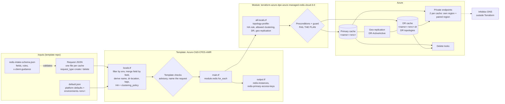
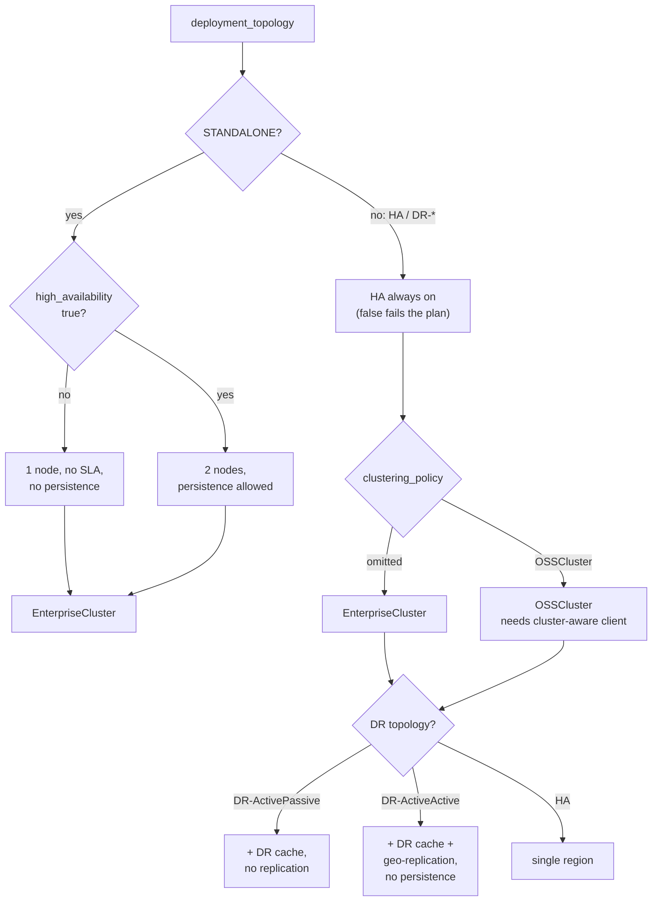
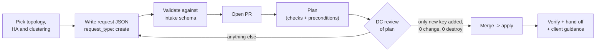

# SOP — Azure Managed Redis Terraform Platform

Sep 24, 2026 · @Sifu · Updated Nov 12, 2026 for module and template v0.5.0

## 1. Purpose, scope and audience

This SOP covers how Azure Managed Redis (AMR) is provisioned, changed, fixed and improved through the platform Terraform stack. It is the one place to look for all four. Application teams self-serve by adding one JSON request file. The DC (Data Cache) team owns everything else.

**In scope**

| Repo                                                | Role                                                                                         | Current version |
| --------------------------------------------------- | -------------------------------------------------------------------------------------------- | --------------- |
| `terraform-azure-dpe-azure-managed-redis-cloud-3-0` | Instance module, published to the Terraform registry under the same name                     | 0.5.0           |
| `Azure-Cld3-CFES-AMR`                               | Onboarding template (root config): `.tf` files, `default.json`, request files, intake schema | 0.5.0           |

**Out of scope:** data-plane work inside Redis (key design, TTLs, application code). The intake only *advises* consumers on the client changes a clustering policy needs (section 8). Also out of scope: shared VNets and subnets, and DNS records for private endpoints. Network engineering owns those; private endpoint DNS is handled by Infoblox automation outside Terraform.

**Responsibilities**

| Activity                                          | App / consumer team           | DC team                                 | DPE team                             | Network / cloud foundation |
| ------------------------------------------------- | ----------------------------- | --------------------------------------- | ------------------------------------ | -------------------------- |
| Submit create / change / delete request file      | Owns                          | Reviews PR                              | Submits via wrapper API              | —                          |
| Topology, HA (Standalone), clustering policy, SKU, auth mode | Chooses within allowed fields | Owns `default.json`, module defaults and the topology policy | Exposes only schema fields; shows client guidance | — |
| TLS, public access, private endpoints, delete lock | —                            | Owns (module-enforced)                  | —                                    | —                          |
| Access key storage in vault                       | Consumes                      | **Open**: owner not decided             | **Open**                             | —                          |
| Shared subnets, private endpoint DNS (Infoblox)   | —                             | Consumes                                | —                                    | Owns                       |
| Client changes for `OSSCluster`                   | Owns                          | Approves the choice                     | Shows guidance in intake             | Opens ports 8500–8599, shard DNS records |
| Module releases and template changes              | —                             | Owns                                    | Validates against Definition of Done | —                          |
| Incident triage and state recovery                | Reports                       | Owns                                    | Supports for wrapper issues          | Supports for network / DNS |

**Conventions:** `<name>` is the request's `instance.name`; `<env>` is one of `dev`, `qa`, `uat`, `preprod`, `prod`. Azure resource names are `<name>-<env>` plus fixed affixes (`-dr`, `pe-`, `lock-`).

## 2. Architecture: how the building blocks interact

The stack has four layers: request JSON, the `Azure-Cld3-CFES-AMR` template, the registry module, and Azure. Each request file becomes one `for_each` key, which drives exactly one module call.



The template only shapes inputs and names offending requests. The module owns every Azure resource, enforces the platform policy, and has no `provider` block, so the template controls subscription and credentials.

### Resolution flow in `locals.tf`

1. **Defaults.** Load `config/onboarding-files-redis/default.json` and the `environments.<env>` block for `var.env`.
2. **Requests.** Load every other JSON in `config/onboarding-files-redis/` whose `environment` equals `var.env` and whose `request_type` is not `delete`. Key them by `instance.name`.
3. **Field-by-field merge.** A request value wins, otherwise the default is used. A shallow `merge()` is avoided on purpose because it would drop nested defaults.
4. **Derivations.** Full name `<name>-<env>`, paired region (`dr_region_pairs`), tags, HA (`high_availability`) and clustering policy (request → `default.json` → module default; RediSearch → `EnterpriseCluster`).
5. **Checks.** Template checks name the offending request (Appendix B). The module's preconditions then fail the plan for anything the platform policy or Azure doesn't allow.

Subscription, network and DNS values are never taken from a request.

### Topologies and platform policy (v0.5.0)

The topology decides HA, which clustering policies are allowed, DR and geo-replication. The policy lives in the module (`all-locals.tf` → `topology-profile`).

| `deployment_topology` | HA                         | Clustering policy (first = default)  | DR instance      | Geo-replication |
| --------------------- | -------------------------- | ------------------------------------ | ---------------- | --------------- |
| `STANDALONE`          | **Optional**, default off  | `EnterpriseCluster`                  | No               | No              |
| `HA`                  | Always on                  | `EnterpriseCluster`, `OSSCluster`    | No               | No              |
| `DR-ActivePassive`    | Always on                  | `EnterpriseCluster`, `OSSCluster`    | Yes, not linked  | No              |
| `DR-ActiveActive`     | Always on                  | `EnterpriseCluster`, `OSSCluster`    | Yes              | Yes             |



| Topology | What gets created |
| --- | --- |
| `STANDALONE` / `HA` | One cache, 2 private endpoints (own region + paired region), delete lock |
| `DR-ActivePassive` | Primary + independent cache in the paired region, 2 private endpoints each (4 total), a lock on each. DR data sync is manual |
| `DR-ActiveActive` | As DR-ActivePassive, plus `azurerm_managed_redis_geo_replication`. Persistence is forced off |

**What HA means.** HA on: at least two nodes, each shard has a primary and a replica on different nodes, automatic failover, zone redundancy where the region has zones, availability SLA, "PAYG Two Node" price. HA off: one node, no replica, about half the price, no SLA, no zone redundancy, no persistence; the cache is down and its data is lost if the node fails or is patched (dev/test only).

**Clustering policy.** `EnterpriseCluster` (default): one endpoint, any standard Redis client, no code changes. `OSSCluster` (HA/DR opt-in): the client connects to each shard directly — best performance, but needs a cluster-aware client, hash-slot-aware keys, ports 8500–8599 and per-shard DNS records. `NoCluster` is **legacy only**: kept for Standalone caches created before v0.5.0, never offered to new requests (section 7).

**Hard-enforced by the module:** TLS (`client_protocol = Encrypted`), public network access disabled, private endpoints, delete locks, and the platform policy above (plan fails otherwise).

### Pipeline

A PR that adds or edits a request file in `Azure-Cld3-CFES-AMR` runs a plan for the target environment. Merge triggers apply. Every run evaluates all request files for that environment together as one plan — so one failing request blocks the whole environment until it's fixed.

## 3. File-by-file reference

Each file does one job. The "Edit when" column tells you which file a given change goes in.

### Template repo: `Azure-Cld3-CFES-AMR`

```
.
├── main.tf                    # module "redis", for_each over merged requests
├── locals.tf                  # load, merge, derive, check blocks
├── variables.tf               # var.env (dev | qa | uat | preprod | prod)
├── output.tf                  # per-instance outputs, access keys (sensitive)
├── provider.tf                # azurerm provider, subscription from default.json
├── config/
│   ├── redis-intake-schema.json         # contract for the DPE wrapper
│   └── onboarding-files-redis/
│       ├── default.json                 # platform + per-environment defaults
│       └── <name>.json                  # one per request (fixtures: test-*.json)
├── CHANGELOG.md
└── README.md
```

| File                       | What it does                                                                                                                                                        | Edit when                                         |
| -------------------------- | ------------------------------------------------------------------------------------------------------------------------------------------------------------------- | ------------------------------------------------- |
| `main.tf`                  | Calls `module "redis"` once per merged request. Holds the module `source` and `version` lines. Passes HA and clustering policy since v0.5.0.                        | Bumping the module version or passing a new input |
| `locals.tf`                | Loads `default.json` and request files, merges field by field, derives name, paired region, tags, HA and clustering policy, holds the `check` blocks                | New request field, new derivation, new guardrail  |
| `variables.tf`             | `var.env` and its allowed values                                                                                                                                    | Adding an environment                             |
| `output.tf`                | `redis-instances` (hostnames, IDs, topology, HA, clustering), `redis-primary-access-keys` (sensitive), `derived-config-by-instance`                                  | Exposing a new module output                      |
| `default.json`             | Platform defaults (incl. `clustering_policy: EnterpriseCluster`), per-environment subscription, regions, resource groups, subnets, `dr_region_pairs`               | New environment, platform default change          |
| `redis-intake-schema.json` | Allowed request fields, enums and cross-field rules; UI hints; `x-client-guidance` per clustering policy. Marks fields the wrapper must never expose (`client_protocol`, `public_network_access`, networking, derived tags). | Any request field change |
| `<name>.json`              | One self-service request. Fixtures: `test-standalone-cache`, `test-standalone-ha-cache`, `test-ha-cache`, `test-ha-modules-cache`, `test-dr-active-passive-cache`, `test-dr-active-active-cache` | Every onboarding, change or decommission |

### Module repo: `terraform-azure-dpe-azure-managed-redis-cloud-3-0`

| File                                             | What it does                                                                                                                                   |
| ------------------------------------------------ | ---------------------------------------------------------------------------------------------------------------------------------------------- |
| `all-locals.tf`                                  | **The** file for module defaults: `topology-profile` (HA rule, allowed clustering policies, DR, geo), legacy NoCluster SKU list, effective values and rule checks |
| `variables.tf`                                   | Inputs and validation (`deployment-topology`, `high-availability-enabled`, `clustering-policy`, `node-type`, `authorization-mode`, `persistence-mode`, `redis-modules`, …) and advisory `check` blocks |
| `main.tf`                                        | `azurerm_managed_redis.primary` / `.dr`, preconditions, clustering policy guard, `azurerm_management_lock.primary` / `.dr` |
| `network.tf`                                     | `azurerm_private_endpoint.primary`, `.primary-paired-region`, `.dr`, `.dr-paired-region`                                                       |
| `geo-replication.tf`                             | `azurerm_managed_redis_geo_replication.geo` (DR-ActiveActive)                                                                                  |
| `data.tf`                                        | Subnet lookups when names are passed instead of IDs                                                                                            |
| `outputs.tf`                                     | Hostnames, IDs, ports, `redis-primary-access-key` (sensitive), `resolved-deployment-topology`, `high-availability-enabled`, `clustering-policy`, … |
| `versions.tf`                                    | `required_providers` only (`azurerm`); no provider block                                                                                       |
| `tests/*.tftest.hcl`                             | `terraform test` with a mocked provider (51 runs in v0.5.0)                                                                                     |
| `README.md`, `CHANGELOG.md`                      | Usage and version history                                                                                                                      |
| `examples/`                                      | Usage samples, not tests                                                                                                                       |

### Terraform addresses used in operations

| Object                 | Address                                                                 |
| ---------------------- | ----------------------------------------------------------------------- |
| Module instance        | `module.redis["<name>"]`                                                |
| Primary cache          | `module.redis["<name>"].azurerm_managed_redis.primary`                  |
| DR cache               | `module.redis["<name>"].azurerm_managed_redis.dr[0]`                    |
| Delete locks           | `module.redis["<name>"].azurerm_management_lock.primary` / `.dr[0]`     |
| Private endpoints      | `module.redis["<name>"].azurerm_private_endpoint.primary`, `.primary-paired-region`, `.dr[0]`, `.dr-paired-region[0]` |
| Geo-replication        | `module.redis["<name>"].azurerm_managed_redis_geo_replication.geo[0]`   |

`terraform state list | grep '<name>'` shows the exact addresses.

## 4. Environment-specific configuration

All environment differences live in `default.json`, not in module code. `var.env` selects which environment block and which request files apply.

### Which values come from where

| Setting                                 | Source                                                      | Request can override?   |
| --------------------------------------- | ----------------------------------------------------------- | ----------------------- |
| Subscription ID                         | `default.json` env block                                    | No                      |
| Subnets, resource groups per region     | `default.json` env block                                    | No                      |
| Paired / DR region                      | `default.json` `dr_region_pairs`                            | No                      |
| Primary region                          | Request, else `default.json`                                | Yes                     |
| `deployment_topology`, SKU              | Request, else `default.json`                                | Yes                     |
| `high_availability`                     | Request (STANDALONE only), else topology default            | STANDALONE only         |
| `clustering_policy`                     | Request, else `default.json` (`EnterpriseCluster`), within the topology's allowed list | HA / DR only (Enterprise or OSS) |
| `authorization_mode`                    | Request, else default (`AccessKey`)                         | Yes                     |
| TLS, public network access, private endpoints, delete lock | Module-enforced                          | No                      |
| Tags                                    | Derived; request adds extra                                 | Derived keys always win |

### Environment matrix

| Env     | Typical topology                    | Clustering                   | Auth                      | Notes                                              |
| ------- | ----------------------------------- | ---------------------------- | ------------------------- | -------------------------------------------------- |
| dev     | STANDALONE                          | EnterpriseCluster            | `AccessKey`               | Delete lock still applied                          |
| qa      | STANDALONE or HA                    | Same as prod                 | `AccessKey`               | Non-prod network                                   |
| uat     | Match prod                          | Same as prod                 | Match prod                | Rehearse prod topology before go-live              |
| preprod | Match prod                          | Same as prod                 | Match prod                | Production-like: warns on Standalone without HA    |
| prod    | HA or DR                            | Enterprise (OSS by exception)| `MicrosoftEntraID` target | Change approval; no persistence with active-active |

Keep the **same clustering policy in every environment** of an application, so the code tested in dev is the code that runs in prod.

### Rules

- **Request names must be unique** per environment; `request-names-unique-per-environment` names the collision.
- **Paired regions** must be configured; `dr-requires-supported-region-pair` and `dr-location-is-a-configured-region` name the offending request.
- **One state per environment.** Never apply prod from a non-prod workspace.
- **No real IDs in placeholders.** **Open:** the dev block holds a real subscription GUID while the other environments hold placeholders; standardize before the repo is shared more widely.

## 5. Prerequisites (one-time per environment)

Three things must exist before the first request in an environment: a deployer identity with the right roles, shared subnets for private endpoints in **both regions of each pair**, and Infoblox automation that registers private endpoint DNS. Terraform does not create any of them.

### Deployer identity (pipeline service principal)

| Role                                                                                               | Scope                 | Why                               |
| -------------------------------------------------------------------------------------------------- | --------------------- | --------------------------------- |
| Contributor (or custom role with `Microsoft.Cache/redisEnterprise/*`)                              | Target resource groups (primary and paired region) | Create and update caches |
| Rights to create private endpoints in the subnet                                                   | Shared subnets / VNets, both regions | Private endpoint creation |
| `Microsoft.Authorization/locks/*` (included in Owner / User Access Administrator, not Contributor) | Resource groups       | Create and remove the delete lock |

The roles must be granted to the **pipeline identity**, not only to an engineer's user account.

### Networking

- A shared subnet for private endpoints exists in the primary region **and** in its paired region (every cache gets an endpoint in both).
- Infoblox registers each private endpoint so the cache hostname resolves to a private IP from client VNets, per region.
- NSGs allow TCP **10000** from client subnets to the endpoint subnets.
- For caches approved for `OSSCluster`: also TCP **8500–8599**, and Infoblox must resolve the per-shard hostnames the cluster returns.

### Onboarding checklist for a new environment

- [ ] Pipeline identity roles granted on resource groups and subnets (both regions)
- [ ] Endpoint subnets present in both regions of each pair
- [ ] Infoblox automation covers the new endpoints
- [ ] Environment added to `variables.tf` validation, the schema's `environment` enum, and `default.json` (`environments.<env>` with real IDs for every region used)
- [ ] Added to `_production_like_envs` in `locals.tf` if production-like
- [ ] Workspace/state for the environment created
- [ ] Smoke test: a STANDALONE request applies, resolves privately and answers `PING`

## 6. Self-service provisioning procedure

A new cache is one new JSON file in `Azure-Cld3-CFES-AMR`, merged through a reviewed PR. No `.tf` edits and no manual Terraform commands.



### Step 1 — Choose topology, HA and clustering

| Need                                                        | `deployment_topology` | `high_availability` | `clustering_policy` |
| ----------------------------------------------------------- | --------------------- | ------------------- | ------------------- |
| Dev/test, disposable cache                                  | `STANDALONE`          | omit (off)          | omit (Enterprise)   |
| Single region, replicated, but no DR                        | `STANDALONE` or `HA`  | `true` for STANDALONE | omit (Enterprise) |
| In-region failover (production)                             | `HA`                  | omit (always on)    | omit, or `OSSCluster` by exception |
| Cold standby in another region, manual data sync acceptable | `DR-ActivePassive`    | omit (always on)    | omit, or `OSSCluster` |
| Cross-region continuity, no persistence needed              | `DR-ActiveActive`     | omit (always on)    | omit, or `OSSCluster` |

`OSSCluster` is approved by the DC team only when the application team confirms the changes in section 8 (client, keys, network).

### Step 2 — Create the request file

Copy the fixture that matches the topology to `config/onboarding-files-redis/<name>.json` and fill only fields in `redis-intake-schema.json`.

- The name must be unique per environment and at most 49 characters.
- Omit any field to inherit `default.json`.
- Never set subscription, network, DNS, TLS or public access fields.
- Never set `clustering_policy: NoCluster` on a new request (legacy only).
- Validate the file against the schema before raising the PR.

### Step 3 — Review the plan (DC team)

- [ ] Only the new key is created: cache, 2 private endpoints and a delete lock; DR topologies add a DR cache, 2 more endpoints and a lock; active-active adds one geo-replication resource.
- [ ] **Zero changes and zero destroys** on any other key
- [ ] Region, paired region, HA and clustering policy are as expected (`derived-config-by-instance` output)
- [ ] No check warnings and no precondition failures

### Step 4 — Merge and apply

Merging triggers apply. DR applies take longest because the DR cache follows the primary.

### Step 5 — Verify and hand off

```bash
az resource show --ids <amr-resource-id> --query properties.hostName -o tsv
nslookup <hostname>          # from a client VNet: must return a private IP
```

- A TLS `PING` on port 10000 returns `PONG`.
- The delete lock is present on the resource.
- Share the hostname and port 10000 with the requesting team, give access (section 8), and send the client guidance for the cache's clustering policy.

## 7. Configuration changes and decommissioning

Every change is an edit to the request file, or to `default.json` for defaults that apply across the platform. It goes through the same PR flow as a new cache.

> ⚠️ **Read the plan, not just the symbol.** A `replace` (`-/+`) recreates the cache and loses its data. With azurerm 4.x, some data-destroying changes show only as `~ update in-place` on `default_database` (Redis modules, and clustering policy — the latter is now blocked by a guard).

### Change matrix

| Change                           | Edit                         | Expected plan                                       | Data / keys / endpoint            | Change class                            |
| -------------------------------- | ---------------------------- | --------------------------------------------------- | --------------------------------- | --------------------------------------- |
| Tags                             | Request                      | Update in place                                     | Kept                              | Standard                                |
| SKU (`node_type`) change         | Request                      | **Replace** (`sku_name` is ForceNew in azurerm)     | Data lost, new keys, endpoints recreated | Treat as new cache + migration   |
| `AccessKey` → `MicrosoftEntraID` | Request                      | Update in place                                     | Kept                              | Infra change; clients must switch first |
| STANDALONE (HA off) → HA, or `high_availability` toggled | Request | **Replace** (`high_availability_enabled` is ForceNew) | Data lost, new keys, endpoints recreated (IP may change) | Treat as new cache + migration |
| STANDALONE with `high_availability: true` → HA (same clustering) | Request | No change | Kept | Standard |
| `clustering_policy` change       | Request                      | **Plan fails** (guard): "Clustering policy change blocked" | — (would be: data lost, new keys) | Not allowed in place: new cache + migration |
| Redis modules added / removed    | Request                      | Shows `~ update in-place` on `default_database` but **deletes and recreates the database** | Data lost, new keys | Treat as new cache + migration |
| Persistence on STANDALONE without HA, or on DR-ActiveActive | — | Plan fails / forced off                             | —                                 | Not allowed                             |
| HA → DR-ActivePassive            | Request                      | Adds DR cache, 2 endpoints, lock                    | Primary kept                      | Infra change                            |
| HA → DR-ActiveActive             | Request                      | Adds DR cache, 2 endpoints, lock, geo-replication; persistence forced off | Primary kept; persistence turned off | Infra change |
| Region or name change            | Request                      | **Destroy and recreate**                            | Data lost                         | Treat as new cache + migration          |
| New environment                  | `default.json` + `variables.tf` + schema | No resources until requested            | —                                 | Platform change                         |
| Module upgrade                   | Template `main.tf` `version` | Varies — must be 0 change / 0 destroy for existing caches unless planned | — | Platform release (section 10) |

### Procedure for an in-place change

1. Edit only the fields you need in `<name>.json`. Never create a second file for the same cache.
2. Open a PR. Confirm the plan shows `~ update in-place` for your key only, with no `-/+` on `azurerm_managed_redis` and no `module` block changes inside `default_database`.
3. For uat/preprod/prod, attach the plan to the change record.
4. Merge, apply, then rerun the verify step from section 6.

### Migrating to a different clustering policy or HA setting

These are never in-place changes. Run them as a new cache:

1. New request with a **new name** (for example `<name>-v2`) and the target topology, HA and clustering policy.
2. Application team makes the client changes (section 8) and tests against the new cache.
3. Migrate data (export/import, dual-write, or rebuild from source) and switch the application to the new hostname and key.
4. Decommission the old request (below).

### Legacy caches created before v0.5.0

Before v0.5.0 the clustering policy came implicitly from the topology (`STANDALONE` → `NoCluster`, `HA`/`DR-*` → `OSSCluster`), so their request files have no `clustering_policy`. Under v0.5.0 they would resolve to `EnterpriseCluster`, and the guard would fail the whole environment's plan. Each existing request therefore carries the policy it already has — one line, no change in Azure:

| Created as | Line in the request's `instance` |
| --- | --- |
| `STANDALONE` | `"clustering_policy": "NoCluster"` (legacy; only STANDALONE, only SKUs ≤ 25 GB) |
| `HA` / `DR-*` without RediSearch | `"clustering_policy": "OSSCluster"` |
| Any topology with RediSearch | nothing (already `EnterpriseCluster`) |

Existing caches at the v0.5.0 upgrade:

| Consumer | Envs | Topology | SKU | Pin |
| --- | --- | --- | --- | --- |
| Axios | dev, qa | HA | B1 | `OSSCluster` |
| IDAM authz | dev, qa | HA | B5 | `OSSCluster` |
| CodeReviewAgent | dev, prod | HA | B10 | `OSSCluster` |
| CWX AXP | qa, prod | HA | B3 | `OSSCluster` |
| NBA | dev | HA | B20 | `OSSCluster` |
| NBA | preprod | HA | B150 | `OSSCluster` |
| RedisML | dev | STANDALONE | B1 | `NoCluster` |
| CryptoAPI | qa | STANDALONE | B1 | `NoCluster` |
| Retail semantic | qa | STANDALONE | B10 | `NoCluster` |
| MacSpider | preprod, prod | STANDALONE | B0 | `NoCluster` |

**Open follow-ups:** NBA preprod (standalone-style client on an OSS cache → new HA + Enterprise cache recommended; check NBA dev); MacSpider prod (single-node B0 in production → new HA + Enterprise cache recommended); brief RedisML, CryptoAPI, Retail semantic and MacSpider before promotion (multi-key commands on Enterprise; RediSearch decision at creation).

### Decommission one cache

1. Get DC approval.
2. Set `"request_type": "delete"` in the request file (or remove the file) and open a PR. The plan must destroy **only** that key: caches, endpoints, locks and geo-replication for `<name>`.
3. Merge.
4. Delete the stored access key from the vault.

The delete lock blocks deletes made **outside** Terraform (portal, CLI). It does **not** block a Terraform destroy or replacement — the lock depends on the cache, so Terraform removes it first. Plan review is the real guard.

### Never do

- Run `terraform destroy` on an environment workspace.
- Remove or filter out an existing request file to "skip" a cache — Terraform plans to destroy it.
- Change caches in the portal; the next apply reverts or conflicts.
- Reuse a name from another request file in the same environment.
- Approve a plan with unexpected `-` or `-/+` on any cache.

## 8. Consumer access and connectivity

A client needs a private network path, a credential, and a client set up for the cache's clustering policy.

| Mode                  | Credential                                        | How it is issued                                                                                                                      |
| --------------------- | ------------------------------------------------- | ------------------------------------------------------------------------------------------------------------------------------------- |
| `AccessKey` (default) | Primary access key                                | `terraform output -json redis-primary-access-keys`, stored in the vault. **Open:** the vault write is manual, and no one owns it yet. |
| `MicrosoftEntraID`    | Entra token for the app's managed identity or SPN | The data-plane grant is manual, outside Terraform. azurerm cannot automate it yet, and the module's advisory check warns about this.  |

### Connecting

1. The client runs in a VNet that resolves the cache hostname to its private endpoint (Infoblox), with a route to the endpoint subnet.
2. Connect to `<hostname>:10000` with TLS.
3. Smoke test with `PING`, then `SET` / `GET` of a test key.

### Client set-up per clustering policy

The intake schema's `x-client-guidance` block has the connection settings per language (Spring Boot, Lettuce, Jedis, StackExchange.Redis, redis-py, node-redis / ioredis, go-redis). Summary:

| | `EnterpriseCluster` (default) | `OSSCluster` (HA/DR by exception) |
| --- | --- | --- |
| Client | Any standard client, configured like a single Redis server | Cluster-aware client (e.g. Spring `spring.data.redis.cluster.nodes`, Lettuce `RedisClusterClient` with topology refresh) |
| Code changes | **None** | Switch to the cluster client; all keys of one multi-key command, transaction or Lua script in one hash slot (`{hash-tags}`) |
| Multi-key commands | Across slots: `DEL`, `MSET`, `MGET`, `EXISTS`, `UNLINK`, `TOUCH`; others need one hash slot | Every multi-key command needs one hash slot |
| Network | Port 10000 | Ports 10000 and 8500–8599; per-shard hostnames must resolve |

**Promotion (dev → preprod/prod)** is a new request in the higher environment. STANDALONE (Enterprise) → HA (Enterprise) needs **no code change**; only the hostname and key differ. STANDALONE → HA with `OSSCluster` needs every change in the OSS column, tested before cut-over.

### Limits to communicate to consumers

- **Never paste keys** into tickets or chat; fetch them from the vault.
- **Data in memory is not encrypted.** Encrypt sensitive fields in the application before writing them.
- **STANDALONE without HA has no replica.** Node failure or patching loses data; use only for dev/test.
- **Active-active has no persistence.** Treat the cache as rebuildable from the source of truth.
- **Clustering policy, HA and Redis modules are create-time choices.** Changing them means a new cache.
- **Conditional Access.** Entra ID tokens are subject to Conditional Access. A request from an untrusted egress, such as Databricks, can fail with `AADSTS53003`. See section 9.

## 9. Troubleshooting runbook

Start with the error text, find its row, and apply the fix. Always run a plan after a fix and before an apply.

### Known errors

| Symptom                                            | Cause                                                                            | Fix                                                                                                                                                          |
| -------------------------------------------------- | -------------------------------------------------------------------------------- | ------------------------------------------------------------------------------------------------------------------------------------------------------------ |
| `Module not found` at `terraform init`             | Template `source` points at a local `./modules/...` path that isn't there        | Use the registry source and `version` (section 10); run `terraform init -upgrade`                                                                            |
| `An argument named "X" is not expected here`       | Template pins a module version older than the input it passes (e.g. `clustering-policy`, `high-availability-enabled` need ≥ 0.5.0) | Bump `version` in `main.tf`; `terraform init -upgrade`                                         |
| **"Clustering policy change blocked for `<name>-<env>`"** | The request's clustering policy differs from the cache's actual one. Usually a pre-v0.5.0 cache whose request lacks `clustering_policy` | Add the policy the cache has today (section 7, legacy table). To really change it, migrate to a new cache |
| "`clustering-policy = 'OSSCluster'` is not offered for deployment-topology = 'STANDALONE'" | STANDALONE only allows Enterprise | Remove `clustering_policy`, or use HA for OSS |
| "`high-availability-enabled = false` is only allowed for deployment-topology = STANDALONE" | `high_availability: false` on HA/DR | Remove `high_availability` from the request |
| "`persistence-mode` … requires high availability"  | Persistence on STANDALONE without HA                                             | Set `high_availability: true`, or persistence `DISABLED`                                                                                                     |
| "Legacy clustering-policy = NoCluster is only possible on … 25 GB or less" | NoCluster pinned on a larger SKU                  | NoCluster is legacy; new caches use Enterprise                                                                                                               |
| Check `request-names-unique-per-environment` fails | Two request files share a name in one environment                                | Rename one, or edit the existing request                                                                                                                     |
| Check `dr-requires-supported-region-pair` / `dr-location-is-a-configured-region` fails | Paired region missing from `dr_region_pairs` or `environments.<env>.regions` | Add the region to `default.json`                                                                                                              |
| Check `geo-replication-requires-supported-sku` warns | DR-ActiveActive on B0/B1 or Flash                                              | Use B3 or larger in-memory SKU                                                                                                                               |
| Advisory warning about `MicrosoftEntraID`          | Data-plane grant cannot be automated                                             | Expected; do the manual grant after apply                                                                                                                    |
| `403` / `AuthorizationFailed` on apply             | Pipeline identity lacks rights on RG, subnet or locks                            | Grant the role to the pipeline identity (section 5); wait a few minutes; re-run                                                                              |
| Persistence rejected on `DR-ActiveActive`          | Azure: geo-replication and persistence are mutually exclusive                    | Use HA with persistence, or active-active without it (module forces it off)                                                                                  |
| Hostname resolves to a public IP or not at all     | Infoblox record missing for the private endpoint                                 | Network team fixes the record                                                                                                                                |
| Timeout on port 10000                              | NSG or route blocks the client subnet                                            | Allow TCP 10000 from the client subnet                                                                                                                       |
| `MOVED` / `CROSSSLOT` errors, or timeouts on 85xx ports | Client not cluster-aware on an `OSSCluster` cache, keys in different hash slots, or 8500–8599 / shard DNS blocked | Use a cluster client and hash tags; open 8500–8599; confirm shard hostnames resolve. If the app can't change, migrate to an Enterprise cache |
| `CROSSSLOT` on an Enterprise cache                 | `MULTI`/`EXEC`, Lua or a multi-key command other than DEL/MSET/MGET/EXISTS/UNLINK/TOUCH across slots | Put related keys in one hash slot (`{hash-tags}`)                                                                                    |
| `AADSTS53003` requesting a token                   | Conditional Access blocks the token request (for example Databricks egress IP)   | Look up the Correlation ID in Entra ID → Sign-in logs; ask the CA owners to allowlist the egress or exclude the identity. Access keys are not subject to CA. |
| `PING` fails with auth error on Entra ID           | Entra authentication not enabled on the cache, or no data-plane grant            | Enable on the Authentication blade; complete the grant                                                                                                       |
| Secret scanner flags a GUID                        | Client/object/subscription IDs near words like `secret`                          | Not a secret; add a scoped ignore. Real secrets stay `sensitive` with no default                                                                             |
| Plan shows `-/+` on the cache                      | Field change forces replacement (SKU, HA, region, name)                          | Stop; treat as migration or revert the field                                                                                                                 |
| Plan shows `~` on `default_database` `module` blocks | Redis modules changed                                                          | Stop: this deletes the database. Treat as migration                                                                                                          |
| Plan wants to destroy a cache nobody asked to delete | Request file removed, renamed, or its `environment` / `request_type` changed  | Restore the file; never "skip" a cache by removing it                                                                                                        |

### Useful diagnostics

```bash
terraform state list | grep '<name>'
terraform plan -refresh-only                         # detect portal drift
terraform output -json derived-config-by-instance    # what each request resolved to
az resource show --ids <amr-resource-id> --query properties.hostName -o tsv
nslookup <hostname>                                  # private IP check
```

### Escalation

| Level | Who                                              | When                                             |
| ----- | ------------------------------------------------ | ------------------------------------------------ |
| L1    | App team                                         | Request-file, schema and client-library errors   |
| L2    | DC team                                          | Plan/apply failures, state recovery, module bugs, policy exceptions (OSSCluster) |
| L3    | Network team / identity team / Microsoft support | Subnets, Infoblox DNS, ports, Conditional Access, capacity |

## 10. Continuous enhancement

The module evolves through semver releases to the Terraform registry. The template adopts a new version through a normal PR. Each change goes in the layer that owns it.

### Where a change belongs

| Change                                                     | Layer                                         | Release needed                       |
| ---------------------------------------------------------- | --------------------------------------------- | ------------------------------------ |
| New default value                                          | `default.json`                                | No, template PR                      |
| New environment, region or subnet                          | `default.json` (+ `variables.tf`, schema enum) | No, template PR                     |
| Topology policy (HA rule, allowed clustering policies)     | Module `all-locals.tf` → `topology-profile`   | Yes, minor (major if existing caches would change) |
| New module-wide default                                    | Module `all-locals.tf`                        | Yes, minor                           |
| New input or output                                        | Module, then template `main.tf` / `output.tf` | Yes, minor                           |
| Removed/renamed input, or a change that forces replacement | Module                                        | Yes, **major** (minor while 0.x), with migration notes |
| New request field                                          | Template `locals.tf` + `main.tf` + intake schema | Template release                  |

### Release procedure (module repo)

1. Branch (e.g. `feature/redis-v0.5.0-ha-clustering-policy`), change code, update `README.md` and `CHANGELOG.md`.
2. Run `terraform fmt -recursive`, `terraform validate` and `terraform test`. Plan all topology fixtures against a dev workspace, using the branch as the source.
3. PR review by a second DC engineer.
4. Merge, then tag and push:

```bash
git checkout main && git pull origin main
git fetch --tags
git tag --sort=-v:refname | head -5
git tag -a vX.Y.Z -m "vX.Y.Z: <summary>"
git push origin vX.Y.Z
```

5. The registry publishes the tag as a new version.
6. Template PR in `Azure-Cld3-CFES-AMR`: bump `version`, plan in every environment (**existing caches: 0 to change, 0 to destroy**), promote dev → qa → uat → preprod → prod.

```hcl
module "redis" {
  source  = "<registry-host>/<ORG>/dpe-azure-managed-redis-cloud-3-0/azure"
  version = "~> 0.5"   # latest 0.5.0; 0.5.0 is required for high_availability / clustering_policy
}
```

**Tag rules:** tags are immutable. Never move a published tag; fix forward with a new patch version.

### Module release history

| Version | Date       | Type              | What changed                                                                                                                                         |
| ------- | ---------- | ----------------- | ---------------------------------------------------------------------------------------------------------------------------------------------------- |
| 0.0.1   | —          | Initial           | Hard-coded proof of concept: primary + conditional DR cache, self-created private DNS zone, one private endpoint                                     |
| 0.0.2   | 2026-08-22 | Minor             | Persistence (RDB/AOF), private DNS zone VNet link, optional DR private endpoint                                                                      |
| 0.0.3   | 2026-08-22 | Breaking          | Restructure: single defaults file, effective-value locals, cross-field checks; provider configuration removed from the module                       |
| 0.0.4   | 2026-08-22 | Breaking          | `prod_mode` replaced by four-way `deployment_topology` driving HA, clustering, DR and geo-replication                                                |
| 0.1.0   | 2026-08-22 | Fix               | Validation and DR-networking fixes found in live four-topology testing                                                                               |
| 0.2.0   | 2026-08-22 | Breaking          | All variables and outputs renamed snake_case → kebab-case                                                                                            |
| 0.2.1   | 2026-08-24 | Patch             | Changelog only                                                                                                                                       |
| 0.2.2   | 2026-08-24 | Patch             | SKU list aligned to current AMR offerings; geo-replication SKU validation                                                                            |
| 0.2.3   | 2026-08-26 | Fix               | Private endpoint drift from Azure-managed `private_dns_zone_group` ignored                                                                           |
| 0.2.4   | 2026-09-10 | Minor             | `dr-resource-group-name`: DR cache and endpoint in their own resource group                                                                         |
| 0.2.5   | 2026-09-11 | Fix               | Race between DR private endpoint and geo-replication                                                                                                |
| 0.2.6   | 2026-09-24 | Minor             | `redis-modules` / `redis-module-args` (RediSearch, RedisJSON, RedisBloom, RedisTimeSeries); RediSearch forces `EnterpriseCluster` + `NoEviction`     |
| 0.3.0   | 2026-10-28 | Breaking (inputs) | `environment` input removed; caller passes the full name. Azure names unchanged                                                                      |
| 0.4.0   | 2026-11-09 | Minor             | Second private endpoint for every cache in the paired region (2 per cache, 4 for DR); no private DNS zone resources (Infoblox)                       |
| **0.5.0** | 2026-11-12 | **Breaking (requests)** | **Platform policy per topology** (STANDALONE: HA optional, Enterprise; HA/DR: HA on, Enterprise or OSS); Enterprise default; NoCluster legacy-only; clustering policy guard; plan-time checks for HA, persistence and policy. Existing requests must pin their current clustering policy |

**Template milestones:** `0.1.1` (Aug 22) JSON request layer, intake schema and plan-time checks; `0.2.0`/`0.2.1` Redis modules fields; `0.3.0` template owns environments and names; `0.4.0` paired-region endpoints; **`0.5.0`** `high_availability` and `clustering_policy` fields, client guidance in the intake schema, legacy pins.

### Enhancement backlog

- [ ] Decide the owner for writing access keys to the vault, then automate the write
- [ ] Automated data-plane grant for `MicrosoftEntraID` once azurerm supports it
- [ ] Guard for Redis module changes on existing caches (same pattern as the clustering policy guard)
- [ ] Remove `FlashOptimized_*` from the geo-replication SKU list (Azure doesn't support it)
- [ ] Align the intake schema's `deletion_protection_enabled` text with the actual lock behavior (section 7)
- [ ] Migrate NBA preprod and MacSpider prod to HA + Enterprise caches; retire legacy NoCluster pins as Standalone caches are replaced
- [ ] Alerting module (mirror the Valkey alerts module)
- [ ] Customer-managed key encryption (roadmap in module README)
- [ ] Diagnostic settings / audit logs to the central workspace
- [ ] CI: run `terraform test` and plan every topology fixture on each module PR; fail on duplicate names and schema-invalid requests; block plans with unexpected deletes
- [ ] Runbook for `DR-ActivePassive` data sync, or accept rebuild-from-source
- [ ] Scheduled `terraform plan -refresh-only` per environment for drift

## 11. Appendix

### A. Request fields

| Field                         | Default source                         | Notes                                                     |
| ----------------------------- | -------------------------------------- | --------------------------------------------------------- |
| `request_type`                | Required                               | `create` (create or update) or `delete`                   |
| `environment`                 | Required                               | Must match `var.env`                                      |
| `instance.name`               | Required                               | Unique per environment, ≤ 49 characters                   |
| `instance.deployment_topology`| `default.json`                         | `STANDALONE`, `HA`, `DR-ActivePassive`, `DR-ActiveActive` |
| `instance.high_availability`  | Topology default                       | STANDALONE only; `true` = 2 nodes. Changing it replaces the cache |
| `instance.clustering_policy`  | `default.json` (`EnterpriseCluster`)   | STANDALONE: Enterprise; HA/DR: Enterprise or OSS; `NoCluster` legacy pin only. Create-time only |
| `instance.node_type` (SKU)    | `default.json`                         | Any change replaces the cache                             |
| `instance.authorization_mode` | `AccessKey`                            | `MicrosoftEntraID` needs a manual grant                   |
| `instance.persistence`        | `DISABLED`                             | Requires HA; forced off for DR-ActiveActive               |
| `instance.eviction_policy`    | `default.json`                         | RediSearch forces `NoEviction`                            |
| `instance.redis_modules` / `redis_module_args` | none                  | Create-time only                                          |
| `instance.location`           | `default.json`                         | Paired region always derived                              |
| `instance.deletion_protection_enabled` | `true`                        | Delete lock; doesn't block Terraform destroys             |
| `instance.tags`               | Derived                                | Extra tags allowed; derived keys win                      |

`redis-intake-schema.json` is the authoritative list.

### B. Guardrail checks

| Check / rule                                     | Where                  | Effect   | Stops                                                  |
| ------------------------------------------------ | ---------------------- | -------- | ------------------------------------------------------ |
| `request-names-unique-per-environment`           | Template `locals.tf`   | Names request | Two requests with the same name                   |
| `dr-requires-supported-region-pair`, `location-is-a-configured-region`, `dr-location-is-a-configured-region` | Template | Names request | Unpaired or unconfigured regions |
| `instance-name-fits-with-environment`            | Template               | Names request | Names too long for `<name>-<env>-dr`             |
| `standalone-is-enterprise-cluster-only`          | Template (0.5.0)       | Names request | OSS on STANDALONE                                |
| `ha-only-optional-for-standalone`                | Template (0.5.0)       | Names request | HA off on HA/DR                                  |
| `persistence-requires-ha`                        | Template (0.5.0)       | Names request | Persistence without HA                           |
| `legacy-nocluster-only-standalone-25gb`          | Template (0.5.0)       | Names request | NoCluster outside its legacy use                 |
| `redis-modules-*`, `redisearch-requires-*`       | Template               | Names request | Invalid module combinations                      |
| `prod-should-not-be-standalone`                  | Template               | Warning  | STANDALONE without HA in preprod/prod                  |
| Topology policy preconditions                    | Module (0.5.0)         | **Plan fails** | Clustering not allowed for the topology; HA off outside STANDALONE; persistence without HA; legacy NoCluster on > 25 GB |
| Clustering policy guard                          | Module (0.5.0)         | **Plan fails** | A clustering policy change wiping an existing cache |
| `deployment-topology` and other input validation | Module                 | **Plan fails** | Unknown values                                    |
| TLS / public access / private endpoints          | Module                 | Enforced | Unencrypted or public caches                           |
| Delete lock                                      | Module                 | Enforced | Deletion outside Terraform                             |
| Entra ID advisory check                          | Module                 | Warning  | Forgetting the manual data-plane grant                 |

### C. Quick commands

```bash
terraform init
terraform plan -var="env=dev"
terraform output -json redis-primary-access-keys    # sensitive: pipe to vault, never print in CI logs
terraform output -json derived-config-by-instance   # resolved topology, HA, clustering per request
terraform state list
terraform test                                      # module repo
az resource show --ids <amr-resource-id> --query properties.hostName -o tsv
```
